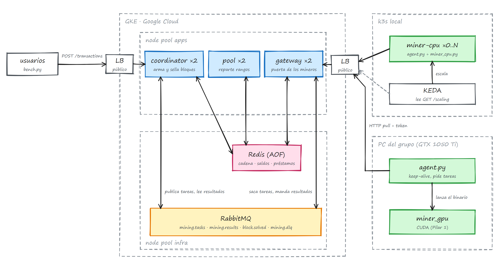

# TP Integrador · Blockchain distribuida con minero CUDA

Sistemas Distribuidos y Programación Paralela · UNLu · Mercedes 2C 2026.
Grupo: Mateo Ponti, María Agustina Ortiz, Federico Kasparian, Justino Bernal.
Entrega y defensa: **viernes 04/12/2026**.

Una blockchain con Proof of Work (MD5) en la que varios mineros trabajan juntos sobre el mismo
bloque, cada uno en un rango de nonces distinto. Los usuarios mandan transferencias, el
coordinator las agrupa en bloques y los mineros (CPU y GPU con CUDA) buscan el nonce.

## Arquitectura



### Qué corre dónde

| Dónde | Qué corre | Carpetas |
|---|---|---|
| **GKE (Google Cloud)**, node pool `apps` | coordinator ×2, pool ×2, gateway ×2 (coordinator y gateway con LoadBalancer público) | código: `pilar2/services/{coordinator,pool,gateway}` · manifiestos: `pilar3/k8s/apps` |
| **GKE**, node pool `infra` | RabbitMQ y Redis (AOF), sin IP pública | `pilar3/k8s/infra` |
| **GKE**, el cluster en sí | red, cluster, 2 node pools, Artifact Registry, Workload Identity | `pilar3/infra/terraform` (OpenTofu) · pipelines 1, 2 y 3 |
| **k3s local** | mineros CPU, de 0 a N réplicas, escalados por KEDA | imagen: `pilar2/services/miners/cpu` · despliegue: `pilar3/k3s-local` · pipeline 4 |
| **PC del grupo** (GTX 1050 Ti) o Colab | minero GPU: `agent.py` + el binario CUDA | `pilar2/services/miners/gpu` · binario: `pilar1/gpu` |

**Ningún minero corre en Google Cloud**: la prueba gratuita prohíbe minar y no tiene GPUs. Los
mineros están afuera y solo hablan con el gateway por HTTP (piden tareas, mandan resultados y
avisan que están vivos), con un token. RabbitMQ y Redis no se exponen.

Los dos mineros comparten el mismo agente (`pilar2/services/miners/agent.py`). Cambia solo el
motor que lanza: `pilar1/cpu/miner_cpu.py` o el binario CUDA `miner_gpu`.

## Pilares

| Carpeta | Pilar | Qué hay |
|---|---|---|
| [`pilar1/`](pilar1/) | 1 · Minero CUDA | Kit de la cátedra, el kernel `gpu/miner_gpu.cu` y un minero CPU multiproceso con el mismo contrato |
| [`pilar2/`](pilar2/) | 2 · Sistema distribuido | coordinator, pool, gateway, mineros y `docker compose` para correr todo local |
| [`pilar3/`](pilar3/) | 3 · GKE y escalado | OpenTofu, manifiestos de GKE y del k3s local (KEDA), pruebas de carga |
| [`docs/`](docs/) | — | Decisiones de diseño, componentes y diagramas |
| `.github/workflows/` | — | CI (gitleaks + tests), Pilar 1 (nvcc) y los pipelines 1 a 4 |

Cada pilar tiene su README con cómo ejecutarlo, su diagrama y sus decisiones de diseño.

## Documentación

- [`docs/decisiones.docx`](docs/decisiones.docx): las decisiones de diseño y por qué.
- [`docs/componentes.docx`](docs/componentes.docx): qué hace cada pieza.
- [`docs/diagrama-completo.excalidraw`](docs/diagrama-completo.excalidraw): diagramas detallados
  (flujo de un bloque, observabilidad, datos, del bloque a los threads CUDA). Se abre en
  [excalidraw.com](https://excalidraw.com).

## Arranque rápido

```bash
# Pilar 1 (en la PC con CUDA 12.x)
cd pilar1 && make test && make check-oracle && make ARCH=sm_61 && make check

# Pilar 2 (local, con Docker)
cd pilar2 && cp .env.example .env && docker compose up -d --build
curl http://127.0.0.1:18080/status
```

Reglas para cualquier IA que use el grupo: [`AGENTS.md`](AGENTS.md).
