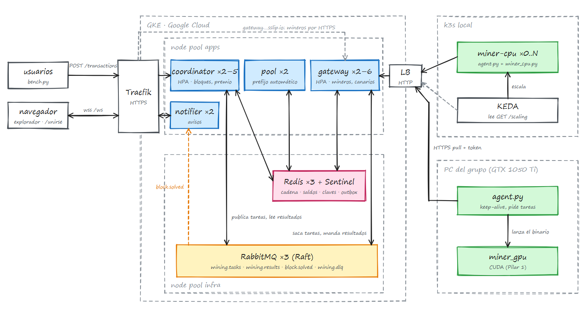

# TP Integrador · Blockchain distribuida con minero CUDA

Sistemas Distribuidos y Programación Paralela · UNLu · Mercedes 2C 2026.
Grupo: Mateo Ponti, María Agustina Ortiz, Federico Kasparian, Justino Bernal.
Entrega: **viernes 04/12/2026** (se movió del 27/11).

Una blockchain con Proof of Work (MD5) en la que varios mineros trabajan juntos sobre el mismo
bloque, cada uno en un rango de nonces distinto. Los usuarios mandan transferencias, el
coordinator las agrupa en bloques y los mineros (CPU y GPU con CUDA) buscan el nonce.

## Arquitectura



### Qué corre dónde

| Dónde | Qué corre | Carpetas |
|---|---|---|
| **GKE (Google Cloud)**, node pool `apps` | coordinator ×2–5, pool ×2, gateway ×2–6 y notifier ×2, detrás de Traefik con HTTPS en un dominio propio detrás de Cloudflare (**`https://sdmer.dpdns.org`** y **`https://gateway.sdmer.dpdns.org`**) | código: `pilar2/services/{coordinator,pool,gateway,notifier}` · manifiestos: `pilar3/k8s/apps` y `pilar3/k8s/https` |
| **GKE**, node pool `infra` | RabbitMQ ×3 (colas quorum con Raft) y Redis (AOF, 1 principal + 2 réplicas + 3 Sentinel), sin IP pública | `pilar3/k8s/infra` |
| **GKE**, el cluster en sí | red, cluster, 2 node pools, Artifact Registry, Workload Identity | `pilar3/infra/terraform` (OpenTofu) · pipelines 1, 2 y 3 |
| **k3s local** | mineros CPU, de 0 a N réplicas, escalados por KEDA | imagen: `pilar2/services/miners/cpu` · despliegue: `pilar3/k3s-local` · pipeline 4 |
| **PC del grupo** (GTX 1050 Ti) o Colab | minero GPU: `agent.py` + el binario CUDA | `pilar2/services/miners/gpu` · binario: `pilar1/gpu` |

**Ningún minero corre en Google Cloud**: la prueba gratuita prohíbe minar y no tiene GPUs. Los
mineros están afuera y solo hablan con el gateway por HTTPS y WebSocket (reciben las tareas, mandan resultados y
avisan que están vivos), con un token. Cualquiera se puede sumar desde `/unirse`: crea su cuenta con claves
Ed25519 y recibe un token propio para su worker. RabbitMQ y Redis no se exponen.

El explorador (`/`) recibe avisos por websocket del notifier: se actualiza solo cuando se sella un bloque.

Los dos mineros comparten el mismo agente (`pilar2/services/miners/agent.py`). Cambia solo el
motor que lanza: `pilar1/cpu/miner_cpu.py` o el binario CUDA `miner_gpu`.

## Pilares

| Carpeta | Pilar | Qué hay |
|---|---|---|
| [`pilar1/`](pilar1/) | 1 · Minero CUDA | Kit de la cátedra, el kernel `gpu/miner_gpu.cu` y un minero CPU multiproceso con el mismo contrato |
| [`pilar2/`](pilar2/) | 2 · Sistema distribuido | coordinator, pool, gateway, notifier, mineros y `docker compose` para correr todo local |
| [`pilar3/`](pilar3/) | 3 · GKE y escalado | OpenTofu, manifiestos de GKE y del k3s local (KEDA), pruebas de carga |
| [`docs/`](docs/) | — | Decisiones de diseño, componentes y diagramas |
| `.github/workflows/` | — | CI (gitleaks + tests), Pilar 1 (nvcc) y los pipelines 1 a 4 |

Cada pilar tiene su README con cómo ejecutarlo, su diagrama y sus decisiones de diseño.

## Documentación

- [`docs/decisiones.docx`](docs/decisiones.docx): las decisiones de diseño y por qué.
- [`docs/componentes.docx`](docs/componentes.docx): qué hace cada pieza.
- [`docs/contrato-1.md`](docs/contrato-1.md): el contrato del grupo SDMER (puntos 1 a 5) y su estado.
- [`docs/diagrama-completo.excalidraw`](docs/diagrama-completo.excalidraw): diagramas detallados
  (flujo de un bloque, observabilidad, datos, del bloque a los threads CUDA). Se abre en
  [excalidraw.com](https://excalidraw.com).

## Arranque rápido

```bash
# Pilar 1 (en la PC con CUDA 12.x)
cd pilar1 && make test && make check-oracle && make ARCH=sm_61 && make check

# Pilar 2 (local, con Docker)
cd pilar2 && cp .env.example .env && docker compose up -d --build
curl http://127.0.0.1:18080/status
```

Reglas para cualquier IA que use el grupo: [`AGENTS.md`](AGENTS.md).

## Uso de IA

### Mateo — Claude Code (Opus 5.5), del 06/11 al 27/11/2026

Usé Claude Code (CLI, modelo Claude Opus 5.5) durante todo el TP, con `AGENTS.md` como reglas fijas: cada
regla dice si sale del enunciado, del kit o del grupo, y la IA no podía decidir las dudas abiertas por su
cuenta, solo proponer opciones.

Para qué partes:

- **Pilar 1:** los 3 TODO del kernel (`pilar1/gpu/miner_gpu.cu`: MD5 de varios bloques, grid-stride en
  `uint64_t` y corte temprano con `atomicCAS`), las mediciones CPU contra GPU y las de la RTX 4060 de InferHive
  (PR #12).
- **Pilar 2:** cuentas con clave Ed25519 y billetera `/cuenta`, notifier por websocket (punto 3), cuenta
  compartida, `/unirse` y alta pública de workers, halving y comisión, y el hashrate real del pool.
- **Pilar 3:** RabbitMQ con 3 nodos y Redis con Sentinel en el cluster del TP3, HTTPS con Traefik y
  cert-manager, las pruebas de carga del 20/11 (CPU y GPU), sacar DuckDNS (PR #9) y, el 27/11, aplicar el
  dominio de Cloudflare de la Task 9 en el cluster (secret del token, issuer DNS-01, Traefik solo para
  Cloudflare y gateway a `ClusterIP`).
- **Documentación:** `docs/decisiones.docx`, `docs/componentes.docx`, `docs/contrato-1.md`, los diagramas
  (`docs/diagrama-completo.excalidraw`) y, en la Task 19, el diagrama Mermaid del Pilar 3 y la fila i del
  contrato.

Cómo validé lo generado:

- **Pilar 1:** `make test`, `make check-oracle` y `make check` (17/17) antes de dar el kernel por terminado,
  y las mediciones con la mediana de 5 corridas y las mismas bases y rangos en CPU y GPU.
- **Servicios:** `pytest -q pilar2/tests pilar3/tests` y el CI (tests + gitleaks) en cada PR.
- **Cluster:** después de cada cambio, verificar en vivo: `/status`, que se selle un bloque y, en el dominio,
  el 301 de http, el 403 de `/logs` y `/metrics` y el timeout de sslip.io y de las IPs viejas.
- Le pedí a la IA que dijera cada comando de `kubectl`, `helm`, `tofu` o `gcloud` antes de correrlo, y los
  que borraban o publicaban algo los aprobé uno por uno.

Lo que corregí o decidí yo: las decisiones de diseño las tomamos en grupo y están en `docs/decisiones.docx`
con su fecha; la IA proponía opciones. _(Completar: qué cambiaste a mano de lo que propuso.)_

### Justino — Codex (26/11/2026)

Se utilizó Codex para revisar el plan de entrega y asistir en las Tasks 4, 5, 6, 13, 17 y 18: validación
de montos y bulks, ganadores después de un rearmado, aceptación/rechazo atómicos de compartidas,
notifier JSON-RPC 2.0 y frontend por eventos, métricas y preparación de la comparación de 4/8 mineros.
La asistencia incluyó implementación, pruebas de regresión, documentación y revisión de compatibilidad
con los cambios de Federico. Los commits usan la identidad Git de Justino; la IA se declara aquí.

Validación ejecutada durante la asistencia:

- `pytest -q pilar2/tests pilar3/tests` con Redis real aislado en la base 15. Los tests de sistema que requieren
  un despliegue no se ejecutaron en esta sesión.
- Casos de Infinity/NaN y exponentes extremos, bulk con fallo intermedio, ganador tardío y dos réplicas
  intentando sellar el mismo bloque, y 50 carreras entre aceptar y rechazar una compartida.
- Errores, suscripciones y eventos JSON-RPC. Ambas páginas en Chromium con API/WS simulados:
  60 s de reloj controlado sin polling, evento, desconexión, fallback y 60 s sin polling al reconectar.
- Muestras de Prometheus y dashboard validado localmente. Ejecutor de carga probado con API/Kubernetes
  simulados, incluyendo restauración ante falla. Esos datos sintéticos son tests, no resultados de entrega.

La rama `justino-merge-final` integra las Tasks 4, 5, 6, 13, 17 y 18 y esta declaración, conservando
los commits originales de Justino. El 27/11 se integró `main` (`4f15176`) con asistencia de Codex:
se resolvieron los conflictos manteniendo el dominio nuevo, JSON-RPC, PPLNS/carry y las métricas.
La combinación pasó 258 tests con Redis real aislado (10 omitidos) y la prueba de las dos páginas en
Chromium. Esta validación local no sustituye las pruebas del despliegue.

Pendientes: revisión de otro integrante, comprobación de métricas en despliegue y carga real del 03/12
sobre el sistema congelado. No se modificaron `bench.py`, `matrix.sh` ni `plot.py`.
