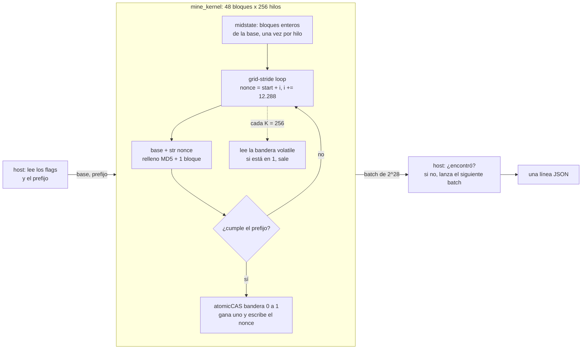

# Pilar 1 · Minero CUDA

## Estado del grupo

| Pieza | Estado |
|---|---|
| `gpu/miner_gpu.cu` | **Hecho (17/11).** Los 3 TODO: MD5 de varios bloques escrito desde el RFC 1321, grid-stride loop en `uint64_t` y corte temprano con `atomicCAS` + bandera `volatile` cada K iteraciones. `make check` → **17/17**. |
| `cpu/miner_cpu.py` | Hecho. Minero CPU multiproceso con el mismo contrato (17/17). Es la "mejor CPU" para el speedup (`--workers 12`) y el motor de la imagen `miner-cpu` del Pilar 2. |
| Mediciones | Hechas (17/11): barrido de parámetros, Hit #6, Hit #7 y comparativa CPU vs GPU (abajo). |
| Integración | El wrapper del Pilar 2 es `pilar2/services/miners/agent.py` (+ `miners/gpu/run.ps1`). Para el coordinador de la cátedra se usa `tools/worker_adapter.py`. |

## Cómo compilarlo y probarlo

GPU del grupo: **GTX 1050 Ti (Pascal, `sm_61`)**, con **CUDA 12.x** (la 13 ya no soporta Pascal).

```bash
make ARCH=sm_61                # Linux, o Git Bash con cl.exe en el PATH (ver abajo)
make test                      # tests del kit: 9/9
make check-oracle              # el oráculo cumple el contrato: 17/17
make check                     # nuestro minero contra los mismos 17 casos: 17/17
./build/miner_gpu --base "<previous_hash><tx_digest>" --difficulty 7 --from 0 --to 99999999999
```

En Windows `nvcc` necesita el compilador de Visual Studio (Build Tools 2022, carga "Desarrollo de escritorio
con C++"). Si `make` dice `Cannot find compiler 'cl.exe'`, agregarlo al PATH antes:
`export PATH="/c/Program Files (x86)/Microsoft Visual Studio/2022/BuildTools/VC/Tools/MSVC/<versión>/bin/Hostx64/x64:$PATH"`.
En Windows `make check` llama a `python3`; si no existe, correr `python tools/check_contract.py -- build/miner_gpu.exe`.

Flags extra (opcionales, con los valores elegidos midiendo): `--threads 256`, `--blocks 0` (= SMs × 8),
`--batch 268435456` y `--poll 256` (K).

## Cómo funciona



- **MD5 (TODO 1):** escrito por nosotros desde el **RFC 1321** (https://www.rfc-editor.org/rfc/rfc1321),
  sección 3: relleno con `0x80`, ceros y el largo en bits en little-endian, y las 4 rondas de 16 pasos con
  las constantes `K[i] = floor(2^32 · |sin(i + 1)|)`. Procesa todos los bloques que hagan falta: una base de
  hasta 160 bytes + 20 dígitos del nonce ocupa hasta 3 bloques (`long-base-d3`). Los bytes son los de la
  cadena UTF-8 que manda el host, así que `ñ` cuenta 2 (`utf8-base`).
- **Midstate:** los bloques de 64 bytes enteros de la base no dependen del nonce. Cada hilo los hashea una
  vez antes del loop y después, por nonce, solo procesa la cola. Con nuestra base de 96 bytes (32 del
  `previous_hash` + 64 del `tx_digest`) es 1 bloque por nonce en vez de 2.
- **Partición (TODO 2):** grid-stride loop con índices `uint64_t` (`big-nonces` cruza 2^32). El hilo `t`
  prueba `start + t`, `start + t + 12.288`, … Los hilos vecinos prueban nonces vecinos y todos terminan a la
  vez. `str(nonce)` usa división de 64 bits solo mientras el número no entra en 32 bits (la de 64 es emulada
  en la GPU).
- **Corte temprano (TODO 3):** el hilo que encuentra hace `atomicCAS(bandera, 0, 1)`: solo el primero que la
  pasa a 1 escribe el nonce. Los demás leen la bandera como `volatile` cada K iteraciones y salen. Entre
  batches, el host también mira la bandera y no lanza el siguiente.
- **No devuelve el nonce más chico:** devuelve el del hilo que gana. Al coordinador no le importa: cualquier
  nonce del rango que cumpla el prefijo es una prueba de trabajo válida, y la verifica igual con un MD5.
- **Rango cerrado y sin inventar:** el loop va de `i = 0` a `count - 1` con `count = to - from + 1`
  (`single-nonce-hit`/`miss`), y si nadie encuentra devuelve `found: false` con los hashes contados
  (`none-in-range`).

## Mediciones (17/11/2026, GTX 1050 Ti vs i5-12400F)

Todas con la misma forma de base que el sistema (96 bytes), 1 corrida de calentamiento y la mediana de 5.
Scripts y datos crudos en `rendimiento/` (`barrido.py` → `barrido.csv`, `comparativa.py` → `comparativa.csv`).

**Parámetros elegidos midiendo** (`barrido.py`, rango de 1.000 M con prefijo imposible):

| Parámetro | Probado | Resultado | Elegido |
|---|---|---|---|
| Hilos por bloque | 32 a 1024 | sube hasta 128 (1.106 MH/s), meseta hasta 512, baja en 1024 (1.060) | **256** |
| Bloques por grid | 6 a 384 | sube hasta 24 (1.103 MH/s), meseta después | **48** (SMs × 8) |
| K (leer la bandera cada K) | 1 a 4096 | 1.081 a 1.099 MH/s: la diferencia es ruido | **256**: casi gratis, y al encontrar los demás hilos hacen a lo sumo 256 × 12.288 ≈ 3 M hashes de más (~3 ms) |
| `--batch` | 2^24 a 2^30 | sin diferencia | **2^28** (~0,25 s por kernel, lejos del watchdog de 2 s de Windows) |

Hashrate: **1.104 MH/s** del motor y 1.013 MH/s de punta a punta (el arranque del proceso cuesta ~0,09 s).
Con eso, en el Pilar 2: `MINER_CHUNK`, `MIN_RANGE_GPU` y `CALIB_RANGE_GPU` = **1.000 M nonces** (~1 s por
llamada, así el arranque pesa < 10 %).

**Hit #6 (prefijos de distinto largo) y Hit #7 (rango con y sin solución), CPU vs GPU** (`comparativa.py`).
Hit #6: 5 bases distintas, las mismas en los dos motores, buscando desde 0. Hit #7: rangos de 100 M nonces
con prefijo de 7 ceros, uno que contiene una solución y otro que no (verificado).

| Caso | CPU 12 procesos | GPU | Speedup |
|---|---|---|---|
| Prefijo 1 a 3 | < 1 ms | ~0,5 ms | gana la CPU: hay muy poco trabajo y la GPU paga su arranque |
| Prefijo 4 | 0,19 s | 0,002 s | 98× |
| Prefijo 5 | 0,30 s | 0,005 s | 56× |
| Prefijo 6 | 3,56 s | 0,021 s | 170× |
| Prefijo 7 | 11,4 s | 0,044 s | 260× |
| Prefijo 8 | (~9 min, no se corrió) | 8,2 s | — |
| Rango **sin** solución (100 M) | 11,75 s · 8,5 MH/s | 0,098 s · 1.020 MH/s | **120×** |
| Rango **con** solución (100 M) | 5,65 s | 0,032 s | 179× |

- **El speedup de referencia es 120×**: es el caso sin solución, donde los dos hacen exactamente el mismo
  trabajo (los 100 M nonces). Es contra la mejor CPU (12 procesos), no contra un solo proceso (sería ~680×).
- Con solución, el tiempo depende de la suerte: cada motor devuelve el primer nonce que cruza, y no es el
  mismo. Por eso los speedups del Hit #6 varían (56× a 260×).
- Con prefijos de 4 y 5 la CPU tarda 0,2 a 0,3 s en levantar los 12 procesos (en Windows es lento); el
  trabajo en sí es de milisegundos.
- El corte temprano se nota en el Hit #7: con solución la GPU tarda un tercio que sin solución.
- En la GPU, `hashes` cuenta un poco más de lo necesario cuando encuentra: los otros hilos terminan su vuelta
  de K antes de ver la bandera (es el costo de K = 256).

---

# Kit de arranque · TPI Pilar 1 (minero CUDA)

Sistemas Distribuidos y Programación Paralela · UNLu · Comisión Mercedes 2026.

Este kit **no** es la solución del Pilar 1. Les da el andamiaje para que el
trabajo de ustedes se concentre en lo que se evalúa: el kernel, la partición
del espacio de nonces, el corte temprano y las mediciones.

```
kit-pilar1/
├── gpu/miner_gpu.cu        esqueleto del minero CUDA (3 TODO para completar)
├── oracle/miner_cpu.py     minero CPU de referencia (el "oráculo" de los tests)
├── tools/check_contract.py verifica que su binario cumple el contrato
├── tools/measure_energy.py mide hashes/s y hashes/J (payload del leaderboard)
├── tools/worker_adapter.py conecta su minero con el coordinador (modo pull)
├── tools/make_vectors.py   regenera tests/vectors.json
├── tests/                  vectores de prueba + tests del kit (pytest)
├── .github/workflows/      CI mínimo: gitleaks + compilar con nvcc + tests
└── Makefile
```

## El contrato del binario

Todo el kit (y la corrección) asume que su minero se invoca así:

```bash
miner_gpu --hash "abc"
# {"hash": "900150983cd24fb0d6963f7d28e17f72"}

miner_gpu --base "<previous_hash><data>" --difficulty 5 --from 0 --to 99999999
# {"found": true, "nonce": 1234567, "hash": "00000...", "hashes": 1300000, "seconds": 0.01}
# {"found": false, "hashes": 100000000, "seconds": 0.05}
```

- La cadena candidata es `base + str(nonce)`: decimal, sin separadores, UTF-8.
  Es exactamente lo que calcula el coordinador de la cátedra.
- `--prefix <hex>` acepta cualquier prefijo hexadecimal (Hit #5 del enunciado);
  `--difficulty d` equivale a `--prefix` con `d` ceros.
- El rango `[from, to]` es cerrado (Hit #7). Si no hay solución: `"found": false`.
- Una sola línea JSON por stdout, código de salida 0 en ambos casos.
  Errores de uso: mensaje por stderr y código 2.

## Pasos

```bash
# 0. Los tests del kit tienen que pasar en su máquina (Python 3.10+ y pytest)
make test
make check-oracle                # el oráculo cumple el contrato: 17/17

# 1. Completen los TODO de gpu/miner_gpu.cu y compilen
make ARCH=sm_89                  # RTX 40xx; sm_86 RTX 30xx; sm_75 Colab T4
make check                       # su minero contra los mismos 17 casos

# 2. Midan energía (en la máquina con la GPU), ~30 s de cómputo sin corte temprano
python3 tools/measure_energy.py --equipo g-su-grupo -- \
  ./build/miner_gpu --base "$(python3 -c 'print("0"*32+"bloque 1")')" \
  --prefix ffffffffffffffff --from 0 --to 60000000000

# 3. Conéctenlo al coordinador de la cátedra (credencial: foro del aula)
export COORDINADOR_URL=https://cadena-sd.impulsate.lat
export CADENA_TOKEN=...          # nunca lo commiteen
python3 tools/worker_adapter.py --minero g-su-grupo-gpu1 --once -- ./build/miner_gpu
```

`-arch=native` necesita CUDA 11.6 o posterior; si su `nvcc` es más viejo,
indiquen la arquitectura a mano.

## Trampas que los vectores detectan a propósito

| Caso | Qué rompe |
|---|---|
| `big-nonces` | usar `int` o `uint32` para el nonce: el rango cruza 2^32 |
| `long-base-d3` | un MD5 que solo procesa un bloque de 64 bytes |
| `utf8-base` | contar caracteres en vez de bytes (`ñ` y `·` ocupan 2 bytes) |
| `none-in-range` | inventar un resultado cuando no hay solución |
| `single-nonce-hit` | errores por uno en los bordes del rango |
| `d4-offset` | ignorar `--from` |

El checker no exige el nonce **más chico**: cualquier nonce del rango que
cumpla el prefijo es válido. Piensen por qué la GPU casi nunca devuelve el
menor, y si eso le importa al coordinador.

## CI

`.github/workflows/pilar1.yml` corre gitleaks, instala solo el compilador
`nvcc` (los runners de GitHub no tienen GPU, pero compilar no la necesita),
compila el minero y corre `make test` y `make check-oracle`. GitHub solo lee
workflows de `.github/workflows/` en la **raíz** del repo: si el kit vive en
`pilar1/`, muevan el archivo a la raíz y agreguen
`defaults: run: working-directory: pilar1` al job de build.

## Seguridad

La credencial del coordinador va por variable de entorno. `.gitignore` ya
excluye `.env` y `build/`. El pipeline de CI del TPI debe correr gitleaks.
