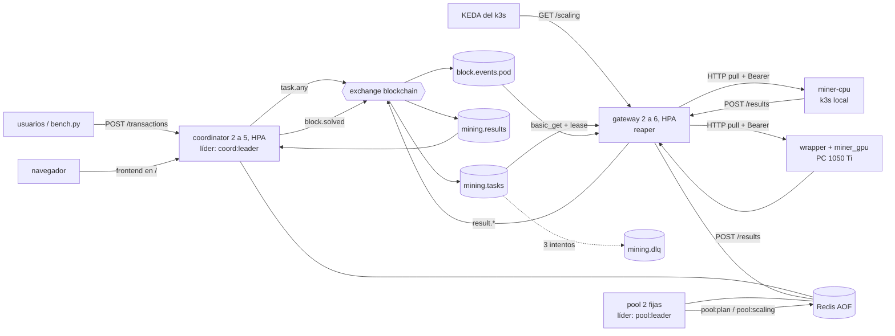

# Pilar 2 · Sistema distribuido (RabbitMQ + Redis + coordinator + pool + gateway + mineros)

Pool de minería **colaborativo**: todos los mineros trabajan sobre el mismo bloque, cada uno en un
rango de nonces distinto. El detalle de cada decisión está en `docs/decisiones.docx`.

## Cómo ejecutarlo (local, con Docker)

```bash
cd pilar2
cp .env.example .env              # credenciales SOLO para local (.env está en .gitignore)
docker compose up -d --build      # RabbitMQ, Redis, coordinator x2, pool x2, gateway x2, miner-cpu x2

curl http://127.0.0.1:18080/status                       # estado de todo (endpoint público)
# http://127.0.0.1:18080/  -> frontend: estado, enviar tx, saldos, mineros y últimos bloques
curl -X POST http://127.0.0.1:18080/transactions -H 'Content-Type: application/json' \
     -d '{"sender":"user-1","receiver":"user-2","amount":10.5}'
python tools/verify_chain.py --url http://127.0.0.1:18080   # verifica la cadena entera

docker compose down               # (-v borra también la cadena de Redis)
```

> Usen `127.0.0.1` y no `localhost`: en Windows `localhost` puede ir a IPv6 y caer en otro servicio de WSL.

**Minero GPU desde la PC** (fuera de Docker, como va a ser en serio), una vez compilado el Pilar 1:

```powershell
$env:GATEWAY_URL = "http://127.0.0.1:18180"; $env:MINER_TOKEN = "<el de .env>"
.\pilar2\services\miners\gpu\run.ps1
```

**Tests:**

```bash
python -m pytest -q pilar2/tests                                       # unitarios
TPI_E2E_URL=http://127.0.0.1:18080 python -m pytest -q pilar2/tests     # + integración y doble gasto (compose levantado)
# Caídas en GKE (mata un pod de cada servicio y verifica la cadena). Necesita un minero conectado.
# 13/11: 6/6 (doble gasto + coordinator, pool, gateway, RabbitMQ y Redis).
TPI_E2E_URL=http://35.223.237.60 TPI_K8S_CONTEXT=gke_tp3distribuidos_us-central1-a_tp3 \
  python -m pytest -v pilar2/tests/test_sistema.py
```

## Arquitectura



| Carpeta | Qué es | Dónde corre |
|---|---|---|
| `services/tpi_common/` | Código compartido: PoW, claves de Redis, topología de RabbitMQ, logs, líder | (librería) |
| `services/coordinator/` | NCT: valida tx, arma el bloque por ventanas, publica tareas por tandas, verifica, sella (Lua), reparte el premio y rearma si cae el hashrate. Sirve el frontend en `/` | GKE |
| `services/pool/` | P5: cada 5 s mide el hashrate real y publica `pool:plan` (prefijo automático + rango), `pool:scaling` y `pool:miners` | GKE |
| `services/gateway/` | Única puerta de los mineros: préstamos (lease), reaper, keep-alive, `/scaling`, calibración, canarios y cuarentena | GKE |
| `services/miners/agent.py` | Agente compartido por los dos mineros (habla con el gateway) | — |
| `services/miners/cpu/` | Imagen `miner-cpu` = agente + `pilar1/cpu/miner_cpu.py` | **k3s local** |
| `services/miners/gpu/` | Scripts para correr agente + `pilar1/build/miner_gpu` | **PC / Colab** |
| `tools/verify_chain.py` | Recorre y verifica la cadena por la API | — |

**Ningún minero corre en GCP** (la prueba gratuita prohíbe minar). En GKE solo van coordinator,
pool, gateway, RabbitMQ, Redis y la observabilidad.

### ¿Por qué los dos mineros están separados pero comparten el agente?

Lo que **cambia** entre CPU y GPU es *dónde* y *cómo se empaqueta*: el CPU es una imagen Docker que
KEDA escala de 0 a N en el k3s; el GPU es un proceso nativo en la PC (Docker en Windows con GPU es
un dolor de cabeza y Colab no corre contenedores). Lo que **no cambia** es cómo hablan con el
gateway. Por eso hay un solo `agent.py` (keep-alive, pedir tarea, minar por tramos, `410` =
abandonar, mandar resultado) y dos **motores** con el mismo contrato CLI del kit:

```
agent.py ──► python pilar1/cpu/miner_cpu.py --base … --prefix … --from … --to …   (CPU)
agent.py ──► pilar1/build/miner_gpu        --base … --prefix … --from … --to …   (GPU, CUDA)
```

Así el gateway y el coordinator ni se enteran de quién minó, y el binario CUDA se testea solo con
`make check` sin tocar nada de red.

## API

**Coordinator** (público): `POST /transactions` · `POST /transactions/bulk` · `GET /transactions/{id}` ·
`GET /balances/{user}` · `GET /accounts` (todas las cuentas, usuarios y cobro de mineros) · `GET /blocks/{i}` · `GET /chain` · `GET /status` · `GET /miners` · `GET /` (frontend) ·
`/health` `/metrics` `/logs`

**Gateway** (todo con `Authorization: Bearer <MINER_TOKEN>`):

| Endpoint | Qué hace |
|---|---|
| `GET /tasks/next?miner_id=&kind=` | Saca una tarea de `mining.tasks`, la presta (`lease:<task_id>`) y la devuelve. `204` si no hay o si el minero está en cuarentena. La primera de cada minero es la **calibración** y 1 de cada `CANARY_EVERY` es un **canario**. |
| `POST /tasks/{task_id}/renew` | El agente pregunta entre tramo y tramo. Renueva el préstamo, o `410` si el bloque ya se cerró. |
| `POST /results` | Publica el resultado en `mining.results` (el coordinator lo verifica de nuevo). |
| `POST /keepalive` | `{miner_id, type: cpu\|gpu, hashrate, account?}` → `worker:<id>` con TTL 15 s y `miner:<id>:account` (cuenta de cobro, 1 día). |
| `GET /scaling` | Señal del pool para KEDA. `503` si el pool no la renovó. |

## Mensajes (JSON, `"v": 1`)

```jsonc
// task (coordinator → mining.tasks)
{"v":1,"task_id":"…","block_id":"3-1a2b3c4d","base":"<prev_hash 32><tx_digest 64>","prefix":"00000","from":0,"to":104857,"attempts":0}
// result (gateway → mining.results)
{"v":1,"task_id":"…","block_id":"3-1a2b3c4d","worker":"gpu-PC","from":0,"to":104857,"found":true,"nonce":48213,"hash":"00000…","hashes":48214,"seconds":0.21,"engine_seconds":0.01}
// tx de premio (primera del bloque siguiente; sender reservado)
{"tx_id":"reward-3-mateo","sender":"recompensa","receiver":"mateo","amount":4500,"ts":…,"reward_for":3}
// block.solved (coordinator → block.events.<pod>)
{"v":1,"block_id":"3-1a2b3c4d","index":3,"block_hash":"00000…"}
```

## Decisiones de diseño (resumen; el detalle está en `docs/decisiones.docx`)

- **Armado por ventanas de tiempo** (comentario del profe, decidido el 13/11). Ventanas fijas de reloj de
  `BLOCK_WINDOW_SECONDS` (10 s: 0–10, 10–20…). Cuando cierra la ventana de la primera tx pendiente, sus tx
  salen en bloques de hasta `MAX_TX_PER_BLOCK` (1000), que se minan uno detrás del otro (cada uno necesita el
  hash del anterior). Un bloque nunca mezcla dos ventanas (1200 de una y 400 de la otra = 1000 / 200 / 400) y
  no hay bloques vacíos. El costo del PoW no depende de cuántas tx tenga el bloque (`tx_digest` mide siempre 64).
- **Coordinadores múltiples:** todas las réplicas atienden la API y verifican resultados; solo el
  líder (`coord:leader`, `SET NX EX` + renovación) arma y publica. El sellado es un script Lua que
  solo escribe si `chain:tip == previous_hash` y el `block_id` sigue vigente, así que dos réplicas
  nunca sellan dos veces ni bifurcan la cadena.
- **Prefijo automático** (13/11). El pool elige el prefijo más largo con el que un bloque tarda menos de
  `BLOCK_TARGET_SECONDS` (10 s) con el **hashrate real** de los mineros vivos (16^n / hashrate). Baja apenas se
  pasa y sube solo con margen (`PREFIX_RAISE_MARGIN`), entre 1 y 8 caracteres. `DIFFICULTY_MODE=fixed` lo fija
  para las pruebas de carga. Sin mineros vale 1. Se guarda en cada bloque.
- **Rearmado:** si se va la GPU a mitad de un bloque y con lo que queda tardaría más de `REARM_FACTOR` × el
  objetivo, el líder rearma el bloque: mismas tx y misma base, prefijo más corto, `block_id` nuevo (las tareas
  viejas se descartan solas).
- **Hashrate real:** el que cada minero entrega en sus resultados (`hashes / engine_seconds`, ventana de 5 min),
  no el que declara en el keep-alive. Solo cuentan las tareas que recorrieron su rango entero: con un prefijo
  corto el nonce aparece enseguida, el arranque del motor domina el tiempo y el prefijo quedaba trabado en 3
  (lo encontró la prueba en GKE). Un minero que dejó vencer un préstamo después de su último resultado
  (zombie) o que está en cuarentena cuenta 0. Mientras no tiene resultados, vale su calibración.
- **Rangos por tandas:** si en `mining.tasks` quedan menos tareas que mineros vivos, el líder
  publica otra tanda desde `block:<i>:next_from` (`INCRBY`, atómico). La cola es un colchón, no mide el trabajo.
- **Tamaño de rango:** fragmentación (`16^largo × POOL_FRAGMENT_PERCENT`, el experimento del 1 % al 50 %), con
  un mínimo según quién mina: `MIN_RANGE_GPU` si hay GPU viva (que llene sus hilos) y `MIN_RANGE_CPU` si no.
- **Mineros CPU (KEDA):** todo o nada. Sin GPU y con trabajo, `CPU_MINERS_MAX`; 60 s sin trabajo, 0; con GPU, 0.
  La GPU no va en KEDA: es una sola placa, y el agente ya la deja en reposo cuando no hay tareas.
- **Calibración** (profe 2): la primera tarea de cada minero es una prueba fija en el gateway (base fija,
  prefijo imposible, `CALIB_RANGE_GPU` / `CALIB_RANGE_CPU`). Da su hashrate inicial y una clase.
- **Canarios:** 1 de cada `CANARY_EVERY` (20) tareas es un rango de un bloque ya sellado que contiene su nonce.
  Si el minero contesta "no encontré", está roto o miente: **cuarentena** (`QUARANTINE_SECONDS`), su trabajo
  de ese bloque no cobra y sus rangos "no encontré" se re-publican. También va a cuarentena con
  `QUARANTINE_AFTER_EXPIRED` préstamos vencidos seguidos. Nada de esto mina en GCP: el canario se arma con datos
  guardados y se verifica con un solo MD5.
- **Premio proporcional** (13/11): `BLOCK_REWARD_CENTS` por bloque, repartido según los nonces que completó
  cada minero antes del sellado (el tamaño de rango que fijó el coordinator, no los `hashes` que informa).
  Se paga con tx `sender="recompensa"` → la **cuenta de cobro** del minero al principio del bloque siguiente; el
  resto del redondeo va al que encontró el nonce. La cuenta de cobro es `MINER_ACCOUNT` del agente (por defecto
  `miner:<id>`): los 8 pods de KEDA de una PC y su GPU, con `MINER_ACCOUNT=mateo`, suman sus partes y cobran
  juntos en `mateo` (si no, cada pod cobraría en una cuenta que muere con él). `MINER_ID` sigue siendo único por
  worker y sirve para las estadísticas. `verify_chain.py` comprueba que sumen el `reward_cents` del bloque anterior.
- **Préstamos:** el gateway hace `basic_get` + ack y guarda `lease:<task_id>` + vencimiento en el
  ZSET `leases:deadline`. El reaper (una réplica, `gateway:reaper:lock`) devuelve lo vencido; al 3er
  intento va a `mining.dlq`, que **no se reprocesa sola** (métrica `tasks_dlq_total` + log).
- **Saldos:** cuentas en centavos enteros. Disponible = `balance − pending_out`, reservado en Lua
  al aceptar la tx; al sellar se mueve el saldo. Génesis: 97 usuarios (`user-0..user-96`, como bench.py).
  `recompensa` es un nombre reservado. `test_sistema.py` prueba el doble gasto con dos tx simultáneas.
- **PoW:** `md5(previous_hash + tx_digest + str(nonce))`, `tx_digest` = SHA-256 del JSON canónico.
- **Frontend:** una página estática servida por el coordinator en `/`, que usa la misma API pública
  (estado, enviar tx, saldos, mineros y bloques). No habla con Redis.
- **Logs** en stdout (JSON), disco (archivo rotativo en `LOG_DIR`) y memoria (`GET /logs`).

### Claves de Redis

Además de las del Word: `mining:current` (candidato que se mina), `tx:status` (dónde está cada tx),
`leases:deadline` (ZSET del reaper), `block:<i>:shares` (nonces completados por minero, para el premio),
`block:<block_id>:notfound:<minero>` (rangos "no encontré", por si falla un canario),
`miner:<id>:results` / `:calibration` / `:expired`, `quarantine:<id>`, `pool:miners`, `pool:last_work` y
`gateway:canary:counter`.

## Pendiente

- **Parámetros CUDA** (threads, bloques, K, `--chunk`): se eligen midiendo cuando esté el kernel.
  Con eso también `MIN_RANGE_GPU` y `CALIB_RANGE_GPU` (ver `pilar1/rendimiento`).
- **Dos colas** (`tasks.gpu` / `tasks.cpu`): se decide después de medir si GPU y CPU minando juntos cambia algo.
- **A futuro, sin hacer:** RabbitMQ con 3 réplicas (quorum) y Redis con réplicas (Sentinel), porque no hay
  recursos en el cluster, y firmas Ed25519 en las tx (hoy cualquiera puede mandar una tx en nombre de otra cuenta).
- **Limitación conocida:** la calibración confía en los `hashes` y `engine_seconds` que informa el minero. Uno
  que mienta puede inflar su hashrate inicial hasta que lo atrapa un canario (en la prueba local, en su primera
  tarea real).
