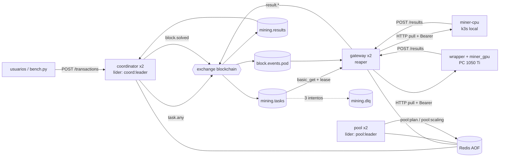

# Pilar 2 · Sistema distribuido (RabbitMQ + Redis + coordinator + pool + gateway + mineros)

Pool de minería **colaborativo**: todos los mineros trabajan sobre el mismo bloque, cada uno en un
rango de nonces distinto. El detalle de cada decisión está en `docs/decisiones.docx` y lo que
falta decidir en `docs/dudas.docx`.

## Cómo ejecutarlo (local, con Docker)

```bash
cd pilar2
cp .env.example .env              # credenciales SOLO para local (.env está en .gitignore)
docker compose up -d --build      # RabbitMQ, Redis, coordinator x2, pool x2, gateway x2, miner-cpu x2

curl http://127.0.0.1:18080/status                       # estado de todo (endpoint público)
curl -X POST http://127.0.0.1:18080/transactions -H 'Content-Type: application/json' \
     -d '{"sender":"user-1","receiver":"user-2","amount":10.5}'
python tools/verify_chain.py --url http://127.0.0.1:18080   # verifica la cadena entera

docker compose down               # (-v borra también la cadena de Redis)
```

> Usen `127.0.0.1` y no `localhost`: en Windows `localhost` puede ir a IPv6 y caer en otro servicio de WSL.

**Minero GPU desde la PC** (fuera de Docker, como va a ser en serio), una vez compilado el Pilar 1:

```powershell
$env:GATEWAY_URL = "http://127.0.0.1:18180"; $env:MINER_TOKEN = "<el de .env>"
.\pilar2\services\miners\gpu\run.ps1
```

**Tests:**

```bash
python -m pytest -q pilar2/tests                                       # unitarios
TPI_E2E_URL=http://127.0.0.1:18080 python -m pytest -q pilar2/tests     # + integración (compose levantado)
```

## Arquitectura



| Carpeta | Qué es | Dónde corre |
|---|---|---|
| `services/tpi_common/` | Código compartido: PoW, claves de Redis, topología de RabbitMQ, logs, líder | (librería) |
| `services/coordinator/` | NCT: valida tx, arma el bloque, publica tareas por tandas, verifica y sella (Lua) | GKE |
| `services/pool/` | P5: cada 15 s publica `pool:plan` y `pool:scaling` | GKE |
| `services/gateway/` | Única puerta de los mineros: préstamos (lease), reaper, keep-alive, `/scaling` | GKE |
| `services/miners/agent.py` | Agente compartido por los dos mineros (habla con el gateway) | — |
| `services/miners/cpu/` | Imagen `miner-cpu` = agente + `pilar1/cpu/miner_cpu.py` | **k3s local** |
| `services/miners/gpu/` | Scripts para correr agente + `pilar1/build/miner_gpu` | **PC / Colab** |
| `tools/verify_chain.py` | Recorre y verifica la cadena por la API | — |

**Ningún minero corre en GCP** (la prueba gratuita prohíbe minar). En GKE solo van coordinator,
pool, gateway, RabbitMQ, Redis y la observabilidad.

### ¿Por qué los dos mineros están separados pero comparten el agente?

Lo que **cambia** entre CPU y GPU es *dónde* y *cómo se empaqueta*: el CPU es una imagen Docker que
KEDA escala de 0 a N en el k3s; el GPU es un proceso nativo en la PC (Docker en Windows con GPU es
un dolor de cabeza y Colab no corre contenedores). Lo que **no cambia** es cómo hablan con el
gateway. Por eso hay un solo `agent.py` (keep-alive, pedir tarea, minar por tramos, `410` =
abandonar, mandar resultado) y dos **motores** con el mismo contrato CLI del kit:

```
agent.py ──► python pilar1/cpu/miner_cpu.py --base … --prefix … --from … --to …   (CPU)
agent.py ──► pilar1/build/miner_gpu        --base … --prefix … --from … --to …   (GPU, CUDA)
```

Así el gateway y el coordinator ni se enteran de quién minó, y el binario CUDA se testea solo con
`make check` sin tocar nada de red.

## API

**Coordinator** (público): `POST /transactions` · `POST /transactions/bulk` · `GET /transactions/{id}` ·
`GET /balances/{user}` · `GET /blocks/{i}` · `GET /chain` · `GET /status` · `/health` `/metrics` `/logs`

**Gateway** (todo con `Authorization: Bearer <MINER_TOKEN>`):

| Endpoint | Qué hace |
|---|---|
| `GET /tasks/next?miner_id=&kind=` | Saca una tarea de `mining.tasks`, la presta (`lease:<task_id>`) y la devuelve. `204` si no hay. |
| `POST /tasks/{task_id}/renew` | El agente pregunta entre tramo y tramo. Renueva el préstamo, o `410` si el bloque ya se cerró. |
| `POST /results` | Publica el resultado en `mining.results` (el coordinator lo verifica de nuevo). |
| `POST /keepalive` | `{miner_id, type: cpu\|gpu, hashrate}` → `worker:<id>` con TTL 15 s. |
| `GET /scaling` | Señal del pool para KEDA. `503` si el pool no la renovó. |

## Mensajes (JSON, `"v": 1`)

```jsonc
// task (coordinator → mining.tasks)
{"v":1,"task_id":"…","block_id":"3-1a2b3c4d","base":"<prev_hash 32><tx_digest 64>","prefix":"00000","from":0,"to":104857,"attempts":0}
// result (gateway → mining.results)
{"v":1,"task_id":"…","block_id":"3-1a2b3c4d","worker":"gpu-PC","from":0,"to":104857,"found":true,"nonce":48213,"hash":"00000…","hashes":48214,"seconds":0.01}
// block.solved (coordinator → block.events.<pod>)
{"v":1,"block_id":"3-1a2b3c4d","index":3,"block_hash":"00000…"}
```

## Decisiones de diseño (resumen; el detalle está en `docs/decisiones.docx`)

- **Un bloque a la vez.** `mining:current` guarda el candidato. Se arma con `MAX_TX_PER_BLOCK` (1000)
  tx o a los `BLOCK_TIMEOUT_SECONDS` (10 s) desde la primera pendiente; al sellar, el siguiente se arma enseguida.
- **Coordinadores múltiples:** todas las réplicas atienden la API y verifican resultados; solo el
  líder (`coord:leader`, `SET NX EX` + renovación) arma y publica. El sellado es un script Lua que
  solo escribe si `chain:tip == previous_hash` y el `block_id` sigue vigente, así que dos réplicas
  nunca sellan dos veces ni bifurcan la cadena.
- **Rangos por tandas:** si en `mining.tasks` quedan menos tareas que mineros vivos, el líder
  publica otra tanda desde `block:<i>:next_from` (`INCRBY`, atómico).
- **Préstamos:** el gateway hace `basic_get` + ack y guarda `lease:<task_id>` + vencimiento en el
  ZSET `leases:deadline`. El reaper (una réplica, `gateway:reaper:lock`) devuelve lo vencido; al 3er
  intento va a `mining.dlq`, que **no se reprocesa sola** (métrica `tasks_dlq_total` + log).
- **Saldos:** cuentas en centavos enteros. Disponible = `balance − pending_out`, reservado en Lua
  al aceptar la tx; al sellar se mueve el saldo. Génesis: 97 usuarios (`user-0..user-96`, como bench.py).
- **PoW:** `md5(previous_hash + tx_digest + str(nonce))`, `tx_digest` = SHA-256 del JSON canónico.
  La dificultad (prefijo) se guarda en cada bloque.
- **Logs** en stdout (JSON), disco (archivo rotativo en `LOG_DIR`) y memoria (`GET /logs`).

### Claves de Redis que agregó el código (no estaban en el Word)

`mining:current` (candidato que se mina), `tx:status` (dónde está cada tx, para `GET /transactions/{id}`)
y `leases:deadline` (ZSET que recorre el reaper). Hay que pasarlas a `decisiones.docx`.

## Pendiente (dudas abiertas, ver `docs/dudas.docx`)

- **Duda 4** (fórmulas del pool): hoy el rango es `16^largo_prefijo × POOL_FRAGMENT_PERCENT` (la
  perilla que mueve `matrix.sh`) y los mineros CPU = 0 si hay GPU viva. Se ajusta después de medir.
- **Dudas 5 y 6:** implementadas con la propuesta (loop de 1 s; campo `ts` en cada tx), configurables.
- **Duda 8:** `MINER_CHUNK` del agente y los parámetros CUDA se eligen midiendo.
- **Duda 11:** el starter del Pilar 3 ya pone `GET /scaling` en el **gateway** (opción A). Así quedó.
