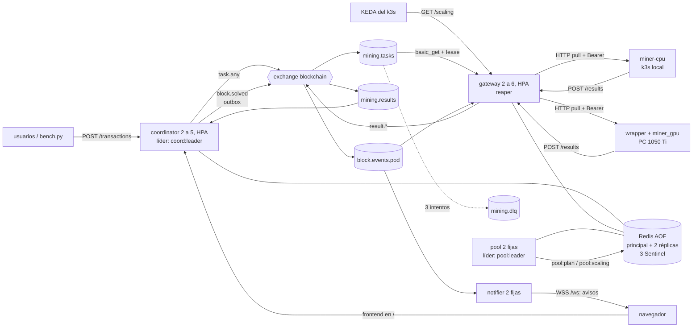

# Pilar 2 · Sistema distribuido (RabbitMQ + Redis + coordinator + pool + gateway + notifier + mineros)

Pool de minería **colaborativo**: todos los mineros trabajan sobre el mismo bloque, cada uno en un
rango de nonces distinto. El detalle de cada decisión está en `docs/decisiones.docx`.

## Cómo ejecutarlo (local, con Docker)

```bash
cd pilar2
cp .env.example .env              # credenciales SOLO para local (.env está en .gitignore)
docker compose up -d --build      # RabbitMQ, Redis, coordinator x2, pool x2, gateway x2, notifier x2, miner-cpu x2

curl http://127.0.0.1:18080/status                       # estado de todo (endpoint público)
# http://127.0.0.1:18080/  -> frontend: estado, enviar tx, saldos, mineros y últimos bloques
# ws://127.0.0.1:18280/ws   -> notifier (avisos por websocket; el frontend se conecta solo)
curl -X POST http://127.0.0.1:18080/transactions -H 'Content-Type: application/json' \
     -d '{"sender":"user-1","receiver":"user-2","amount":10.5}'
python tools/verify_chain.py --url http://127.0.0.1:18080   # verifica la cadena entera

docker compose down               # (-v borra también la cadena de Redis)
```

> Usen `127.0.0.1` y no `localhost`: en Windows `localhost` puede ir a IPv6 y caer en otro servicio de WSL.

**Minero GPU desde la PC** (fuera de Docker, como va a ser en serio), una vez compilado el Pilar 1:

```powershell
$env:GATEWAY_URL = "http://127.0.0.1:18180"; $env:MINER_TOKEN = "<el de .env>"
.\pilar2\services\miners\gpu\run.ps1
```

**Minero GPU en InferHive** (21/11/2026, lo pidió el profe: "alquilás y usás desde el namespace"). Cada alumno
tiene un namespace de Kubernetes en InferHive (`alumno-<nombre>`); la GPU sale de la cuota `alumno-endpoint` (1 pod,
1 GPU) y solo está dentro de la franja reservada en el panel (*Reserve GPU*). La imagen se compila para la 1050 Ti
(`sm_61`) y las que alquila InferHive: GTX 1650 SUPER (`sm_75`), RTX 3090 (`sm_86`) y RTX 4060 (`sm_89`).

```bash
docker build -f pilar2/services/miners/gpu/Dockerfile -t ghcr.io/<owner>/tpi-miner-gpu:latest . && docker push ghcr.io/<owner>/tpi-miner-gpu:latest
. ~/Downloads/connect.sh ~/Downloads/<alumno>.kubeconfig     # túnel de Cloudflare (cloudflared) + KUBECONFIG
kubectl create secret generic minero-gpu --from-file=miner-token=<archivo con el token de /unirse>
kubectl apply -f pilar2/services/miners/gpu/inferhive.yaml && kubectl logs -f deploy/miner-gpu
```

El token es el de un worker dado de alta en `/unirse` (por ejemplo `mateo.inferhive`): pasa por "en prueba" y los
canarios como cualquier worker de afuera y cobra en la cuenta del dueño. La imagen tiene que ser pública en ghcr.io
(InferHive la baja sin credenciales). Sale por HTTPS al gateway; no necesita IP pública ni puertos (InferHive no da).

**Tests:**

```bash
python -m pytest -q pilar2/tests                                       # unitarios
# Lua (reserva, firmas de compartidas, aceptar, liquidar colectas) y reaper del gateway, contra un Redis real.
# Usan la base 15 y la borran; sin REDIS_URL se saltean. En el CI corren con un servicio Redis.
docker run -d -p 6379:6379 redis:7.4-alpine
REDIS_URL=redis://localhost:6379/15 python -m pytest -q pilar2/tests/test_lua.py
TPI_E2E_URL=http://127.0.0.1:18080 python -m pytest -q pilar2/tests     # + integración y doble gasto (compose levantado)
# Caídas en GKE (mata un pod de cada servicio y verifica la cadena). Necesita un minero conectado.
# 13/11: 6/6 (doble gasto + coordinator, pool, gateway, RabbitMQ y Redis).
TPI_E2E_URL=https://sdmer.dpdns.org TPI_K8S_CONTEXT=gke_tp3distribuidos_us-central1-a_tp3 \
  python -m pytest -v pilar2/tests/test_sistema.py
```

Los tests de sistema se actualizaron el 21/11 (los había dejado viejos el cambio de cuentas): las cuentas de prueba
se registran con clave Ed25519 y gastan firmando con su `seq` (antes mandaban a nombres sin registrar y daban `400
destino inexistente` antes de probar nada), y el doble gasto espera 19,90 (100,00 − 80,00 − 0,10 de comisión). Hay
uno nuevo con `seq` distinto. Contra el compose del 21/11: integración + 2 de doble gasto, **3/3**. Las caídas en
GKE no se volvieron a correr después de este cambio (la última, 6/6, es del 13/11).

**Recuperación (arreglos del 21/11, a partir de una auditoría externa):**
- **Lote en vuelo sin candidato.** Si el líder del coordinator se cae entre sacar el último lote de `tx:pending`
  (`TAKE_LUA`) y guardar `mining:current`, el siguiente veía la cola vacía y no lo retomaba hasta que llegara otra
  tx; `pending_count` tampoco lo contaba. Ahora `_assemble` mira primero `tx:inflight:<índice siguiente>` y lo
  retoma, y el contador cuenta ese lote por el índice, no por el candidato. Probado en compose: con los dos
  coordinators frenados se movió el lote a "en vuelo" a mano; al volver, el líder lo retomó solo (`retomado: true`
  en el log) y la tx se confirmó en el bloque 72 sin que entrara otra.
- **Shares sin vencimiento.** Tenían `EXPIRE` de 24 h, pero son el derecho a cobrar el premio, que se paga al armar
  el bloque siguiente: si ese bloque salía más de 24 h después (sin tx no hay bloques), el premio no se le pagaba a
  nadie. Ahora se borran recién en el `SEAL_LUA` del bloque siguiente, ya pagadas.
- **Propuesta trabada en "admitiendo".** Ver "Cuentas compartidas": el líder la retoma a los 30 s.
- **Aporte de colecta en un solo paso.** Reservar el saldo y anotar el aporte (quién, cuánto, `tx_id`) eran pasos
  separados: un corte en el medio dejaba una tx minable que la liquidación no conocía. Ahora lo hace el mismo
  `RESERVE_LUA` (recibe las claves de la colecta cuando el destino es `colecta:<id>`).
- **Ventanas que no se mezclan.** Dos tx que llegan casi juntas pueden quedar en la cola en orden inverso a su
  hora. Si la primera era de la ventana siguiente, el lote se llevaba también la de la anterior. `TAKE_LUA` ahora
  toma solo tx de la ventana de la primera (`inicio <= ts < fin`) y corta en la primera que no lo es. Probado con
  `redis-cli --eval`: con B (10,01 s) delante de A (9,99 s), el lote de [10, 20) se llevó solo B.
- **Nombres.** La cuenta personal y la compartida se guardan en claves distintas y cada alta solo miraba que no
  existiera la otra: dos altas simultáneas del mismo nombre pasaban las dos. Ahora las dos reservan `name:<cuenta>`
  con `SET NX` (probado a la vez: una 201 y la otra 409). Los nombres nuevos son 1 a 64 letras, números, `.`, `-` o
  `_`: antes valía cualquier texto, una cuenta con `/` daba 404 en `/balances/…` y el nombre va adentro del
  comando que se copia en `/unirse`.
- **`/status` con Redis caído.** El primer chequeo lo detectaba, pero la lectura siguiente tiraba excepción (500).
  Ahora responde 200 con `redis: down`, los demás servicios y lo que sale de Redis en `null` (probado parando Redis
  en el compose). `/health` sigue siendo solo "el proceso vive".
- **Lo que ve el usuario.** Una colecta liquidada dice "devolución pendiente" o "pago pendiente" hasta que esas tx
  están en un bloque, y después "devuelta en el bloque N" con link (antes decía "devuelta" al reservarlas: el
  bloque 604 tardó casi 12 h porque no había mineros prendidos). "Mis workers" dice "minando" solo si entregó
  trabajo en los últimos 2 min, muestra "en prueba" y el último trabajo. El portal explica que se cobra por shares.
  El buscador avisa si el bloque no existe todavía o si nadie usó ese nombre (antes `user-999` salía como cuenta
  del génesis), los `tx_id` de las listas tienen link, el número de cada bloque es un link (teclado), el detalle
  del bloque recalcula de verdad su comprobación (`/blocks/{i}/verify`), y las tablas piden solo encabezados
  (`/blocks?start=&limit=`) en vez de bloques enteros. Al reconectar, `/cuenta` lee los bloques que se perdió y
  completa los movimientos.
- **Grafana.** El panel "Altura de la cadena" sumaba `blocks_sealed_total`, que vuelve a 0 al reemplazar un pod.
  Ahora usa `chain_height`, la altura que guarda Redis.
- **Mineros del k3s.** Van por HTTPS (`https://gateway.sdmer.dpdns.org`, A2 del 27/11), KEDA usa un `scaling-token` propio
  en vez del token de los mineros, y el pipeline 4 reemplaza la URL que haya (antes buscaba un marcador que ya no
  estaba).

## Arquitectura



| Carpeta | Qué es | Dónde corre |
|---|---|---|
| `services/tpi_common/` | Código compartido: PoW, claves de Redis, topología de RabbitMQ, logs, líder | (librería) |
| `services/coordinator/` | NCT: valida tx, arma el bloque por ventanas, publica tareas por tandas, verifica, sella (Lua), reparte el premio y rearma si cae el hashrate. Sirve el frontend en `/` | GKE |
| `services/pool/` | P5: cada 5 s mide el hashrate real y publica `pool:plan` (prefijo automático + rango), `pool:scaling` y `pool:miners` | GKE |
| `services/gateway/` | Única puerta de los mineros: préstamos (lease), reaper, keep-alive, `/scaling`, calibración, canarios y cuarentena | GKE |
| `services/notifier/` | Punto 3 del contrato: avisos por websocket (bloque sellado, tx confirmada, cuenta que se movió) a los navegadores | GKE |
| `services/miners/agent.py` | Agente compartido por los dos mineros (habla con el gateway) | — |
| `services/miners/cpu/` | Imagen `miner-cpu` = agente + `pilar1/cpu/miner_cpu.py` | **k3s local** |
| `services/miners/gpu/` | Scripts para correr agente + `pilar1/build/miner_gpu`, y la imagen `miner-gpu` (`Dockerfile`, `inferhive.yaml`) | **PC / Colab / InferHive** |
| `tools/verify_chain.py` | Recorre y verifica la cadena por la API | — |

**Ningún minero corre en GCP** (la prueba gratuita prohíbe minar). En GKE solo van coordinator,
pool, gateway, notifier, RabbitMQ, Redis y la observabilidad.

### ¿Por qué los dos mineros están separados pero comparten el agente?

Lo que **cambia** entre CPU y GPU es *dónde* y *cómo se empaqueta*: el CPU es una imagen Docker que
KEDA escala de 0 a N en el k3s; el GPU es un proceso nativo en la PC (Docker en Windows con GPU es
un dolor de cabeza y Colab no corre contenedores). Lo que **no cambia** es cómo hablan con el
gateway. Por eso hay un solo `agent.py` (keep-alive, pedir tarea, minar por tramos, `410` =
abandonar, mandar resultado) y dos **motores** con el mismo contrato CLI del kit:

```
agent.py ──► python pilar1/cpu/miner_cpu.py --base … --prefix … --from … --to …   (CPU)
agent.py ──► pilar1/build/miner_gpu        --base … --prefix … --from … --to …   (GPU, CUDA)
```

Así el gateway y el coordinator ni se enteran de quién minó, y el binario CUDA se testea solo con
`make check` sin tocar nada de red.

## API

**Coordinator** (público): `POST /transactions` · `POST /transactions/bulk` · `GET /transactions/{id}` ·
`GET /balances/{user}` · `GET /accounts` (todas las cuentas, usuarios y cobro de mineros) ·
`POST /crowdfunds` · `GET /crowdfunds` · `GET /crowdfunds/{id}` (colectas; ya liquidadas, `settlement` dice si las
tx del pago o la devolución están en un bloque) · `GET /blocks/{i}` · `GET /blocks?start=&limit=` (solo
encabezados y cantidad de tx, para las tablas) · `GET /blocks/{i}/verify` (recalcula SHA-256 de las tx, MD5,
prefijo y enlace) · `GET /chain` · `GET /status` (con Redis caído responde igual, con lo que no sabe en `null`) ·
`GET /miners` · `GET /` (explorador) · `GET /cuenta` (billetera) · `GET /unirse` (sumar un worker) ·
`/health` `/metrics` `/logs`. Toda la API documentada en `/docs`.

**Gateway** (todo con `Authorization: Bearer <MINER_TOKEN>`):

| Endpoint | Qué hace |
|---|---|
| `GET /tasks/next?miner_id=&kind=` | Saca una tarea de `mining.tasks`, la presta (`lease:<task_id>`) y la devuelve. `204` si no hay o si el minero está en cuarentena. `204` también si ya tiene `MAX_LEASES_PER_MINER` (2) préstamos abiertos (20/11): uno que pida sin parar no se lleva la tanda entera. La primera de cada minero es la **calibración** y 1 de cada `CANARY_EVERY` es un **canario**. |
| `POST /tasks/{task_id}/renew?miner_id=` | El agente pregunta entre tramo y tramo. Renueva el préstamo, o `410` si el bloque ya se cerró o el minero está en cuarentena (en ese caso la tarea vuelve a la cola). `409` si el préstamo es de otro minero (26/11). |
| `POST /tasks/{task_id}/release?miner_id=` | "No pude": el agente devuelve la tarea cuando se le rompe el motor. Vuelve a la cola al instante (sin esperar los 60 s) y cuenta como falla. `410` si el préstamo ya no existe y `409` si es de otro minero. |
| `POST /results` | **Firmado** (26/11, punto f): `signature` sobre `sdmer:<chain>:result:<task_id>:<1\|0>:<nonce>:<sha256 de las shares ordenadas>` con la clave atada al worker; sin `authorize` o con firma mala → `401` (y el préstamo sigue siendo suyo). Publica el resultado en `mining.results` (el coordinator lo verifica de nuevo). Con token propio, el `worker` del resultado sale del token. **Desde el 26/11 (B1.3):** `409` si el préstamo es de otro minero, y `from`, `to`, `block_id` y `share_prefix` salen **del préstamo**, no del pedido. Sin préstamo (venció y se re-publicó), un "no encontré" da `410` y un "encontré" se reenvía igual con `from = to = nonce` (el coordinator lo verifica con MD5, así no se pierde un bloque). |
| `POST /keepalive` | `{miner_id, type: cpu\|gpu, hashrate, account?}` → `worker:<id>` con TTL 15 s y `miner:<id>:account` (cuenta de cobro, 1 día). |
| `GET /scaling` | Señal del pool para KEDA. `503` si el pool no la renovó. Acepta el `SCALING_TOKEN` de solo lectura (21/11: KEDA ya no usa el token de los mineros) o uno de minero. |
| `WS /ws/miners?miner_id=&kind=` | **Canal de trabajo** (26/11, puntos c y f del contrato, JSON-RPC 2.0 como Stratum). El gateway manda `mining.challenge` `{challenge, chain_id}`; el worker contesta `mining.authorize` `{worker, pubkey, signature}` firmando `sdmer:<chain>:authorize:<worker>:<challenge>` con su clave Ed25519 (si no, error `-32001` y se cierra). Después el gateway **empuja** las tareas con `mining.notify` (una a la vez por conexión: la siguiente apenas se cierra el préstamo de la anterior) y sigue avisando `block.solved`. La entrega, `renew` y `release` siguen por HTTP. Si el WebSocket se corta, el agente vuelve a pedir por HTTP, y la tarea que tenía vence y el reaper la re-publica. |
| `GET /miners/challenge?miner_id=` · `POST /miners/authorize` | `authorize` por HTTP (el agente lo hace al arrancar, así puede firmar aunque el WebSocket no ande). Desafío de un solo uso y 60 s. |

## Mensajes (JSON, `"v": 1`)

```jsonc
// task (coordinator → mining.tasks)
{"v":1,"task_id":"…","block_id":"3-1a2b3c4d","base":"<prev_hash 32><tx_digest 64>","prefix":"00000","from":0,"to":104857,"attempts":0}
// result (gateway → mining.results)
{"v":1,"task_id":"…","block_id":"3-1a2b3c4d","worker":"gpu-PC","from":0,"to":104857,"found":true,"nonce":48213,"hash":"00000…","hashes":48214,"seconds":0.21,"engine_seconds":0.01}
// tx de premio (primera del bloque siguiente; sender reservado)
{"tx_id":"reward-3-mateo","sender":"recompensa","receiver":"mateo","amount":4500,"ts":…,"reward_for":3}
// tx común: el servidor le agrega la comisión (fee) al aceptarla
{"tx_id":"…","sender":"user-1","receiver":"user-2","amount":1050,"fee":10,"ts":…}
// block.solved (coordinator → outbox → block.events.<pod>: lo escuchan el gateway y el notifier)
{"v":1,"event_id":"block-3","type":"block.solved","block_id":"3-1a2b3c4d","index":3,"block_hash":"00000…","timestamp":…,"miner":"gpu-PC",
 "txs":[{"tx_id":"…","sender":"user-1","receiver":"user-2","amount":1050}]}
```

## Decisiones de diseño (resumen; el detalle está en `docs/decisiones.docx`)

- **Armado por ventanas de tiempo** (comentario del profe, decidido el 13/11). Ventanas fijas de reloj de
  `BLOCK_WINDOW_SECONDS` (10 s: 0–10, 10–20…). Cuando cierra la ventana de la primera tx pendiente, sus tx
  salen en bloques de hasta `MAX_TX_PER_BLOCK` (1000), que se minan uno detrás del otro (cada uno necesita el
  hash del anterior). Un bloque nunca mezcla dos ventanas (1200 de una y 400 de la otra = 1000 / 200 / 400) y
  no hay bloques vacíos. El costo del PoW no depende de cuántas tx tenga el bloque (`tx_digest` mide siempre 64).
- **Coordinadores múltiples:** todas las réplicas atienden la API y verifican resultados; solo el
  líder (`coord:leader`, `SET NX EX` + renovación) arma y publica. El sellado es un script Lua que
  solo escribe si `chain:tip == previous_hash` y el `block_id` sigue vigente, así que dos réplicas
  nunca sellan dos veces ni bifurcan la cadena.
- **Prefijo automático** (13/11). El pool elige el prefijo más largo con el que un bloque tarda menos de
  `BLOCK_TARGET_SECONDS` (10 s) con el **hashrate real** de los mineros vivos (16^n / hashrate). Baja apenas se
  pasa y sube solo con margen (`PREFIX_RAISE_MARGIN`), entre 1 y 8 caracteres. `DIFFICULTY_MODE=fixed` lo fija
  para las pruebas de carga. Sin mineros vale 1. Se guarda en cada bloque.
- **Rearmado:** si se va la GPU a mitad de un bloque y con lo que queda tardaría más de `REARM_FACTOR` × el
  objetivo, el líder rearma el bloque: mismas tx y misma base, prefijo más corto, `block_id` nuevo (las tareas
  viejas se descartan solas).
- **Hashrate real:** el que cada minero entrega en sus resultados (`hashes / engine_seconds`, ventana de 5 min),
  no el que declara en el keep-alive. Solo cuentan las tareas que recorrieron su rango entero: con un prefijo
  corto el nonce aparece enseguida, el arranque del motor domina el tiempo y el prefijo quedaba trabado en 3
  (lo encontró la prueba en GKE). Un minero que dejó vencer un préstamo después de su último resultado
  (zombie) o que está en cuarentena cuenta 0. Mientras no tiene resultados, vale su calibración.
- **Rangos por tandas:** si en `mining.tasks` quedan menos tareas que mineros vivos, el líder
  publica otra tanda desde `block:<i>:next_from` (`INCRBY`, atómico). La cola es un colchón, no mide el trabajo.
- **Tamaño de rango:** fragmentación (`16^largo × POOL_FRAGMENT_PERCENT`, el experimento del 1 % al 50 %), con
  un mínimo según quién mina: `MIN_RANGE_GPU` si hay GPU viva (que llene sus hilos) y `MIN_RANGE_CPU` si no.
- **Mineros CPU (KEDA):** todo o nada. Sin GPU y con trabajo, `CPU_MINERS_MAX`; 60 s sin trabajo, 0; con GPU, 0.
  La GPU no va en KEDA: es una sola placa, y el agente ya la deja en reposo cuando no hay tareas.
- **Calibración** (profe 2): la primera tarea de cada minero es una prueba fija en el gateway (base fija,
  prefijo imposible, `CALIB_RANGE_GPU` / `CALIB_RANGE_CPU`). Da su hashrate inicial y una clase.
- **Canarios** (rehechos el 26/11, pedido B1.1 del profe): 1 de cada `CANARY_EVERY` (20) tareas es un rango **del
  bloque actual** que otro minero ya resolvió y cuyas shares el coordinator ya verificó con MD5
  (`block:<i>:verified`, los últimos 200). Tiene el mismo formato que una tarea real (`blocks.new_task`: mismo
  `block_id`, base, prefijo, `share_prefix` y tamaño), así que el minero no lo puede distinguir. Además su respuesta
  no es pública: antes el canario era un rango de un bloque **sellado**, cuyo nonce salía en `GET /blocks/{i}`.
  Pasa si devuelve todas las shares conocidas de ese rango (si el original mandó `MAX_SHARES`, alcanza con
  `MAX_SHARES` válidas). Nunca le toca un rango propio. Si en el canario aparece la solución del bloque (el original
  dijo "no encontré" y mintió), se reenvía al coordinator como un resultado más.
  Si falla, está roto o miente: **cuarentena** (`QUARANTINE_SECONDS`), su trabajo
  de ese bloque no cobra y sus rangos "no encontré" se re-publican. También va a cuarentena con
  `QUARANTINE_AFTER_EXPIRED` préstamos vencidos seguidos (o devueltos con `release`). Nada de esto mina en GCP:
  el canario se arma con datos guardados y se verifica con el MD5 de unas ~32 shares.
- **Hashrate medido** (26/11, B1.2): el hashrate que cuenta (prefijo automático, clase, `/miners`) sale de las
  **shares que verifica el gateway con MD5** (`Σ shares · 16^largo / segundos medidos por el gateway`, con al menos
  `MIN_SHARES_TO_MEASURE` = 20 shares en la ventana), no de lo que informa el minero (hashes y `engine_seconds` del
  motor, el keep-alive o la calibración, que se pueden inflar). La calibración queda solo como valor inicial hasta
  tener medición. En `/miners`, `source: "shares"`. En el explorador la columna "Medido" es esa; "Informa el motor" y
  "Declarado" quedan a la vista pero no se usan.
- **Clave del worker y TOFU** (26/11, punto f): cada worker tiene su clave Ed25519 (`MINER_KEY_FILE`, por defecto
  `~/.sdmer/<miner_id>.key`, o `/tmp/sdmer/` si el home no se puede escribir, como en los pods; el agente la crea si
  no existe). El gateway la **ata al worker en el primer `authorize`** (`workerkey:<id>`, vence a los 7 días sin uso),
  como el `known_hosts` de SSH: el token dice quién es y la clave prueba que es el mismo de antes y firma sus
  resultados. Se eligió esto en vez de generar la clave del worker en `/unirse` porque sirve igual para los pods del
  k3s (que no pasan por `/unirse`) y no cambia el alta. Perder la clave obliga a dar de alta otro worker. El agente
  firma con el código de referencia del RFC 8032 (solo stdlib, porque corre en Colab); `test_push.py` verifica que da
  lo mismo que `cryptography`. `REQUIRE_SIGNED_RESULTS=0` apaga la exigencia (solo para una transición).
- **Vardiff** (26/11, punto d del contrato, como Stratum): con el hashrate medido, el gateway le pone a cada tarea
  que presta el largo de share de ese worker (`tpi_common/vardiff.py`), apuntando a `VARDIFF_SHARES_PER_SECOND` (10)
  shares por segundo: uno rápido recibe shares más difíciles (menos MD5 que verificar) y uno lento más fáciles. El
  peso de cada share es `16^largo`, así que el premio no cambia. Límites por tarea: entre 8 y `MAX_SHARES` (256)
  shares esperadas, porque con menos los canarios y la medición se quedan sin datos y con más se cortarían. Como el
  prefijo es hex (cada largo es 16 veces más difícil), por cada tamaño de tarea entran 1 o 2 largos: Vardiff separa
  a los mineros muy distintos, no afina como la dificultad continua de Stratum. Los canarios usan el largo del minero
  (filtrando las shares conocidas), así siguen siendo iguales a sus tareas.
- **Límite de identidades** (26/11, B1.4, contra granjas Sybil): altas de cuentas (`REGISTER_PER_IP_HOUR`, 20) y
  de workers (`WORKERS_PER_IP_HOUR`, 20) por IP y por hora → `429`. La IP sale de `CF-Connecting-IP` (Cloudflare),
  después de `X-Forwarded-For` (Traefik) y si no, de la conexión (`tpi_common/ratelimit.py`).
- **Fallas** (13/11): no hay un "falló" que el minero mande; el sistema las detecta solo.
  - Un **"encontré" que no verifica** (MD5 o rango) lo detecta el coordinator: cuarentena, no cobra el bloque, y
    ese rango y sus "no encontré" se re-publican.
  - Con **cuarentena por préstamos vencidos** (se colgó, no mintió) lo que ya terminó sigue valiendo; solo deja de
    recibir tareas. La lógica común está en `tpi_common/quarantine.py`.
  - Un minero en cuarentena tampoco puede renovar ni entregar "no encontré" (`410`): ese rango lo hace otro.
  - Un minero **zombie** (keep-alive sin entregar trabajo) no cuenta como vivo: si es una GPU colgada, el pool
    pide mineros CPU apenas le vence la tarea, sin esperar a la cuarentena.
  - Si se le rompe el motor, el agente no se muere: devuelve la tarea con `release` y sigue.
- **Premio PPLNS** (27/11, A3-e; de 13/11 al 26/11 era proporcional al trabajo de ese bloque, PROP):
  `BLOCK_REWARD_CENTS` por bloque, repartido entre las últimas `PPLNS_N` (2) veces el trabajo que cuesta un
  bloque (`N × 16^largo del prefijo`), **sin importar en qué bloque se hizo ese trabajo**. El trabajo se mide con
  **shares** verificadas (ver "Shares" y "Premio PPLNS" más abajo); antes del 20/11 era el tamaño de los rangos
  que el minero decía haber recorrido.
  Se paga con tx `sender="recompensa"` → la **cuenta de cobro** del minero al principio del bloque siguiente; el
  resto del redondeo va al que encontró el nonce. La cuenta de cobro es `MINER_ACCOUNT` del agente (por defecto
  `miner:<id>`): los 8 pods de KEDA de una PC y su GPU, con `MINER_ACCOUNT=mateo`, suman sus partes y cobran
  juntos en `mateo` (si no, cada pod cobraría en una cuenta que muere con él). `MINER_ID` sigue siendo único por
  worker y sirve para las estadísticas. `verify_chain.py` comprueba que sumen el `reward_cents` del bloque anterior.
- **Préstamos:** el gateway hace `basic_get` + ack y guarda `lease:<task_id>` + vencimiento en el
  ZSET `leases:deadline`. El reaper (una réplica, `gateway:reaper:lock`) devuelve lo vencido; al 3er
  intento va a `mining.dlq`, que **no se reprocesa sola** (métrica `tasks_dlq_total` + log).
- **Saldos:** cuentas en centavos enteros. Disponible = `balance − pending_out`, reservado en Lua
  al aceptar la tx; al sellar se mueve el saldo. Génesis: 97 usuarios (`user-0..user-96`, como bench.py).
  El `tx_id` lo genera siempre el servidor: si viene en el body se ignora (si no, alguien podría adelantarse
  al id de un premio, `reward-<i>-<cuenta>`, o bloquearle ids a otro cliente).
- **Génesis:** el bloque 0 lo crea el coordinator al arrancar (`ensure_genesis` en `coordinator/blocks.py`), con
  un Lua que solo escribe si la cadena está vacía (las 2 réplicas lo intentan y gana una). No se mina:
  `previous_hash` = 32 ceros, `prefix` vacío, nonce 0, timestamp 0 y 97 tx `genesis → user-i` de 1.000.000.
  Es siempre igual, así que su hash también (`d2a7ee64…`).
  `recompensa` es un nombre reservado. `test_sistema.py` prueba el doble gasto con dos tx simultáneas.
- **PoW:** `md5(previous_hash + tx_digest + str(nonce))`, `tx_digest` = SHA-256 del JSON canónico.
- **Frontend:** una página estática servida por el coordinator en `/`, que usa la misma API pública
  (estado, enviar tx, saldos, mineros y bloques). No habla con Redis.
- **Logs** en stdout (JSON), disco (archivo rotativo en `LOG_DIR`) y memoria (`GET /logs`).

### Cuentas con clave (punto 1 del Contrato SDMER, decidido el 17/11/2026, opción A)

- **La única forma de tener una cuenta propia es registrarse con un par de claves Ed25519.** La clave
  privada nunca sale de la PC del usuario; al servidor solo llega la pública.
  `POST /accounts/register {account, public_key, signature}`: la firma es sobre `register:<account>:<public_key>`
  y prueba que el que registra tiene la clave privada. Se guarda en `account:<nombre>:pubkey` con `SET NX`
  (una cuenta no cambia de dueño).
- **Toda tx de una cuenta registrada va firmada:** `{sender, receiver, amount, seq, signature}`. La firma es
  sobre `tx:<sender>:<receiver>:<centavos>:<seq>`, y `seq` tiene que ser el último + 1
  (`account:<nombre>:seq`). Sin firma, con firma mala o con `seq` repetido → `400`. El `seq` evita que alguien
  copie una tx firmada y la mande de nuevo (replay).
- **Id de la cadena en todo lo que se firma** (26/11, A3-g del contrato, como EIP-155): lo que se firma de verdad es
  `sdmer:<CHAIN_ID>:<mensaje>` (`CHAIN_ID=2026`), para todos los mensajes de esta sección y de las de abajo
  (registro, tx, alta de workers, compartidas, propuestas y colectas). Una firma hecha para otra red (por ejemplo el
  compose local con otro `CHAIN_ID`) no vale en esta. Se agrega en un solo lugar de cada lado: `firmas.verify` en el
  servidor y `firmar()` en `claves.js`. Los clientes lo leen de `GET /chain-id` (también sale en `/status`). Una
  firma sin chain id (un front o un `tools/cuenta.py` de antes) → `400` con un mensaje que dice que hay que actualizar.
- **Excepción fija: las 97 cuentas de prueba del génesis (`user-0` a `user-96`)** no se registran y mandan tx
  sin firma, porque es lo que hace el `bench.py` de la cátedra (no se puede modificar). Son las únicas cuentas
  sin firma. No se pueden registrar esos nombres, ni `recompensa` ni los que empiezan con `miner:`.
- Una tx de un sender que no es del génesis y no está registrado se rechaza (`400`, cuenta no registrada).
- **El destino tiene que existir** (decidido el 20/11, opción A): una cuenta del génesis, una registrada con clave,
  una compartida o una colecta abierta. Si no, `400 la cuenta destino no existe`. Vale también para las propuestas
  de una cuenta compartida. Por qué: en Bitcoin se puede mandar a una dirección que nadie usó, porque la dirección
  sale de la clave (hash de la pública) y nadie puede apropiársela después. Acá el nombre se elige y la clave se
  asocia después: plata mandada a `mateoo` por error se la quedaba el primero que registrara `mateoo`.
- **No se puede registrar un nombre que ya tiene saldo** (`409`): cubre lo que quedó de antes de la regla (en GKE,
  `asdasdasasdasd` y `sda`, 40,00 en total, quedan sin dueño).
- **La cuenta de cobro de un minero tiene que estar registrada** (`MINER_ACCOUNT`, en el keep-alive; si no, `400` y el
  agente lo avisa en el log). La de por defecto, `miner:<id>`, sigue valiendo: nadie la puede registrar.
- **El génesis solo transfiere dentro del génesis** (26/11, pedido A1 del profe; reemplaza la "limitación conocida"
  del 20/11): como `user-0..96` no firman, cualquiera puede mandar en su nombre. Hasta el 26/11 eso permitía llevarse
  los ~97M del génesis a una cuenta propia, contra menos de 100.000 que va a emitir el premio en total. Ahora una tx
  de una cuenta del génesis a cualquier cuenta que no sea del génesis → `400` ("las cuentas del génesis solo
  transfieren a otras cuentas del génesis"). Al génesis sí se le puede mandar.
  - De las tres opciones del profe se eligió esta porque es la única que no rompe `bench.py` (no firma, no se puede
    modificar y manda solo entre `user-0..96`). Anclar cada cuenta a una clave obligaba a firmar en `bench.py`. Bajar
    el génesis a montos chicos dejaba el mismo agujero, solo que más chico.
  - Consecuencia: la plata de las cuentas propias sale **solo del minado** (premio + comisiones). Para probar con una
    cuenta propia hay que minar con `MINER_ACCOUNT=<cuenta>` o recibir de alguien que tenga saldo. Los tests de doble
    gasto de `test_sistema.py` se fondean desde una cuenta así (`TPI_FONDOS_CUENTA` / `TPI_FONDOS_KEY`).
- Cliente: `pilar2/tools/cuenta.py` (`claves`, `registrar`, `enviar`). `GET /balances/<cuenta>` dice si está registrada y su último `seq`.
- ~~Pendiente: `MINER_ACCOUNT` sin registrar~~ → **resuelto el 20/11**: tiene que ser una cuenta registrada (ver arriba).

### Páginas: explorador, billetera y alta de workers (20/11/2026)

Separadas como en Bitcoin y Ethereum, donde la billetera (Electrum, MetaMask) no tiene nada que ver con minar, y
como en los exploradores (mempool.space, Etherscan), que son solo de lectura:

| Página | Para quién | Qué tiene |
|---|---|---|
| `/` explorador | cualquiera, solo lectura | altura, pendientes, prefijo, hashrate del pool, mineros conectados, bloques, cuentas, estado de una tx y **"Mis workers"** (como en los pools: buscás tu cuenta y ves tus workers con el hashrate real, el efectivo, el que informa el worker y si están en cuarentena) |
| `/cuenta` billetera | cualquiera, mine o no | crear la cuenta (claves Ed25519 en el navegador, se descarga `<cuenta>.key`), abrirla con el `.key` (se comprueba contra la clave pública de `GET /balances`), saldo y movimientos en vivo por el notifier, enviar transferencias firmadas con el `seq` siguiente, y las cuentas de prueba del génesis (sin firma) |
| `/unirse` | quien quiere minar | cargar la cuenta con su `.key` (si no tiene, link a `/cuenta`), dar de alta el worker firmando con la cuenta y copiar el comando |
| Grafana (dashboard "TPI Blockchain") | el grupo | lo de administración que salió del explorador: mineros CPU pedidos a KEDA, hashrate calibrado y declarado de cada minero, cuarentena, líder del coordinator, pods arriba por servicio y navegadores conectados al notifier |

El alta del worker sigue **firmada** por la cuenta (en los pools alcanza con poner la dirección): así nadie le
asocia workers ajenos a tu cuenta. La clave privada no sale del navegador; el worker recibe solo su token.
`GET /status` y `GET /miners` siguen públicos (lo pide el enunciado y los datos son los mismos).

### Página "¿Querés minar con nosotros?" y alta de workers (17/11/2026, opción A)

Como en los pools de minería, el alta está separada del explorador: `http://<coordinator>/unirse` (el explorador
sigue en `/`). Tres pasos: (1) crear la cuenta: el navegador genera las claves Ed25519 (WebCrypto), registra la
pública y descarga la privada en `<cuenta>.key` (mismo formato que `tools/cuenta.py`); (2) dar de alta el worker:
la cuenta firma `worker:<cuenta>:<worker>` y el gateway (`POST /workers/register`, con CORS) devuelve un **token
propio**; (3) copiar el comando para minar con CPU o GPU.
- El token se muestra una sola vez; en Redis queda su sha256 (`workertoken:<hash>` → `{miner_id, account}`).
- Con token propio, el `miner_id` (`cuenta.worker`) y la cuenta de cobro salen del token: el agente no los puede
  cambiar. El premio va a la cuenta registrada (cierra el hueco de `MINER_ACCOUNT` sin dueño).
- Si el worker falla un canario, además de la cuarentena se le **revoca el token**.
- El `MINER_TOKEN` compartido sigue para los pods del k3s (KEDA).
- **En prueba** (20/11): un worker nuevo recibe 1 canario cada `TRIAL_CANARY_EVERY` (5) tareas y no cobra hasta pasar
  `TRIAL_CANARIES` (3). Después queda como cualquier otro (1 canario cada 20). Clave `trial:<id>` (no empieza con
  `worker:` porque `alive_workers` escanea `worker:*`). Los pods del k3s no pasan por la prueba.
- **La cuarentena crece y, con token propio, revoca** (20/11): cada cuarentena en la última hora dura el doble que la
  anterior (5, 10, 20, 40 min, con tope de 1 h: `QUARANTINE_MAX_SECONDS`), y la 3.ª en una hora
  (`REVOKE_AFTER_STRIKES`) revoca el token de un worker de `/unirse`. Un "encontré" inválido también revoca, igual
  que un canario fallado. Así, pedir tareas y dejarlas vencer a propósito sale caro. Cuenta en `miner:<id>:strikes`
  (vence a la hora). Probado en local: la 3.ª cuarentena duró 20 min y el pedido siguiente dio `401`.
- **Límite de préstamos por minero** (20/11): hasta 2 tareas prestadas a la vez (`MAX_LEASES_PER_MINER`). Antes no había
  límite: un programa que pidiera 100 tareas seguidas se llevaba la tanda entera y el bloque se demoraba hasta que
  vencían sus préstamos (60 s). Un agente honesto tiene como mucho 1 (pide la siguiente después de entregar); el 2.º
  lugar sobra para cuando se le cae el programa y la tarea vieja todavía no venció. Se reserva el lugar con un Lua
  antes de sacar la tarea (`miner:<id>:leases`), así 50 pedidos simultáneos no pasan todos: probado, se prestan 2.
- **Límite por cuenta** (20/11): hasta `MAX_WORKERS_PER_ACCOUNT` (10) altas; la 11.ª da `429`. Los revocados siguen
  contando, así que mentir cuesta un lugar. Se controla con un Lua (`workers:of:<cuenta>`).
- Con token propio, el gateway pone el `worker` de cada resultado a partir del token. Antes lo mandaba el agente:
  un worker podía firmar resultados con otro nombre, cobrar en otra cuenta o saltearse la prueba (lo encontramos
  en la prueba local del 20/11).

### Notificaciones por websocket (punto 3 del Contrato SDMER, 20/11/2026)

Como dice el Word ampliado del contrato: un servicio **notifier** (2 réplicas) atiende los websockets de los
navegadores en `/ws` (Traefik lo pasa por HTTPS: `wss://sdmer.dpdns.org/ws`). No decide nada: escucha
`block.solved` y avisa. Desde el 26/11, el protocolo es **JSON-RPC 2.0**. Explorador y cuentas se actualizan por
avisos o acciones del usuario: con WebSocket conectado no hay polling. Durante un corte hay un solo fallback
de 15 s por página, que se elimina al reconectar. Las fotos iniciales recuperan el estado vigente.

```jsonc
// cliente → notifier
{"jsonrpc":"2.0","id":1,"method":"sdmer_subscribe","params":["newBlocks"]}
{"jsonrpc":"2.0","id":2,"method":"sdmer_subscribe","params":["tx","…"]}
{"jsonrpc":"2.0","id":3,"method":"sdmer_subscribe","params":["account","user-2"]}
{"jsonrpc":"2.0","id":4,"method":"sdmer_unsubscribe","params":["0x0123456789abcdef"]}
// notifier → cliente
{"jsonrpc":"2.0","id":2,"result":"0x0123456789abcdef"}
{"jsonrpc":"2.0","method":"sdmer_subscription","params":{"subscription":"0x0123456789abcdef","result":{"type":"snapshot","height":25,"tx_id":"…","status":"pending","block":null}}}
{"jsonrpc":"2.0","method":"sdmer_subscription","params":{"subscription":"0x0123456789abcdef","result":{"type":"event","event":"tx.confirmed","tx_id":"…","index":25,"block_hash":"000000…"}}}
{"jsonrpc":"2.0","id":4,"result":true}
```

Errores: `-32700` JSON inválido, `-32600` pedido inválido, `-32601` método inexistente,
`-32602` parámetros inválidos, `-32603` error interno y `-32000` límite de suscripciones.
Se aceptan lotes; los pedidos sin `id` no generan respuestas JSON-RPC.

Validación local (26/11): `test_notifier_jsonrpc.py` cubre protocolo, rutas y errores.
`python pilar2/tests/browser_notifier.py` ejecuta ambas páginas en Chromium con APIs simuladas y reloj
controlado: 60 s conectado sin polling, actualización por `newBlocks`, fallback de 15 s y otros 60 s sin
polling tras reconectar. Requiere instalar `playwright` y `python -m playwright install chromium`.

- **Outbox (transactional outbox):** el `SEAL_LUA` guarda el evento en `events:outbox` en el mismo script que sella.
  Después se publica en RabbitMQ y recién ahí se saca del outbox; si el pod o RabbitMQ se caen en el medio, el
  líder lo vuelve a publicar en su loop (cada 1 s). Puede salir dos veces: el notifier descarta repetidos por
  `event_id` y al gateway no le cambia nada recibir dos veces el mismo `block_id`.
- **Una cola por réplica** (`block.events.<pod>`, como el gateway): un navegador está conectado a una sola réplica,
  así que cada una tiene que recibir todos los bloques. Una cola compartida los repartiría y alguno se perdería.
- **Reconexión:** el cliente primero se suscribe y después recibe la **foto** del estado (`snapshot`, con `height`
  como versión; un evento con `index < height` ya está en la foto). WebSocket no guarda los avisos perdidos
  mientras estuvo desconectado: se garantiza recuperar el estado vigente, no cada aviso (historial con cursor =
  extensión, como dice el Word).
- **Límites:** `Origin` del mismo host o de `NOTIFIER_ALLOWED_ORIGINS`, 50 suscripciones por conexión, mensajes de
  hasta 4 KB, 1000 conexiones por réplica, sesión de 1 h (después se corta y el cliente se reconecta), ping cada
  20 s (uvicorn) y **cliente lento**: si se le juntan 200 avisos sin enviar se lo corta en vez de llenar la memoria.
- **Sin autenticación por ahora:** hoy los saldos y las tx ya son públicos por la API (`/balances`, `/chain`), así
  que suscribirse a una cuenta no muestra nada nuevo. Si el grupo decide que el saldo sea privado (pendiente), el
  notifier tiene que pedir una firma de la cuenta para suscribirse a ella.
- Métricas: `notifier_connections`, `notifier_subscriptions`, `notifier_messages_total`, `notifier_rejected_total`
  y en el coordinator `outbox_events_published_total`.
- Prueba (compose local, 20/11): dos clientes en réplicas distintas, tx confirmada avisada a los 6,9 s, movimiento de
  cuenta en la otra réplica, reconexión con foto al día, evento repetido en el outbox avisado una sola vez y origen
  ajeno rechazado.

### Cuentas compartidas (punto 2 del Contrato SDMER, 20/11/2026)

Una cuenta con varios dueños y un mínimo de firmas (m de n), con el flujo de Safe (Ethereum) y del multisig de
Polkadot: un dueño propone un pago, los demás firman lo mismo y al juntar el mínimo el pago entra como una tx más.

| Ruta | Qué hace |
|---|---|
| `POST /multisig` | Crea la cuenta: `{account, owners, threshold, creator, signature}`. Firma un dueño sobre `multisig:create:<cuenta>:<m>:<dueños separados por coma>`. Los dueños tienen que ser cuentas registradas. Queda **pendiente** hasta que acepten todos |
| `POST /multisig/{cuenta}/accept` · `/reject` | Un dueño acepta firmando **la misma definición** que el creador (`multisig:create:…`) o rechaza firmando `multisig:reject:<cuenta>`. Con todos, queda **activa**; con un rechazo, queda **rechazada** |
| `POST /multisig/{cuenta}/proposals` | Un dueño propone: `{receiver, amount, nonce, signer, signature}`, firmando `multisig:<cuenta>:<para>:<centavos>:<nonce>` |
| `POST /multisig/proposals/{id}/sign` | Otro dueño firma el mismo texto |
| `GET /multisig/{cuenta}` · `GET /multisig/proposals/{id}` · `GET /multisig?owner=` | Ver la cuenta y sus propuestas, una propuesta, y las cuentas de un dueño |

- **Cada dueño tiene que aceptar** (20/11, como Polkadot): antes la creaba uno sin que los demás aceptaran (como Safe), y
  cualquiera podía meter a otro en cuentas (spam). Pendiente: no recibe plata ni se proponen pagos. Las invitaciones se
  ven en `/cuenta` (`GET /multisig?owner=` devuelve `accounts` e `invites`). Las cuentas de antes cuentan como activas.
- **Mínimo 2 firmas** (20/11): el contrato pide una transferencia con *aprobación extra*; con 1, cualquier dueño gastaría
  solo y sería una cuenta común con varios dueños. El que propone ya firma, así que con 2 de 3 alcanza con otro más.
- El **id de la propuesta es el hash del texto firmado** (como Polkadot): cambiar el monto o el destino da otra
  propuesta, así que las firmas de una no sirven para la otra.
- Una firma por dueño (firmar dos veces no suma). Agregar la firma y ver si se llegó al mínimo es **un solo Lua**
  (`SIGN_LUA`): si dos dueños firman a la vez, solo uno admite el pago.
- Mientras faltan firmas **no se reserva saldo**. Al llegar al mínimo se reserva monto + comisión con el mismo Lua de
  siempre. **Si no alcanza, queda esperando saldo** (21/11, como Safe: las firmas siguen valiendo y se ejecuta cuando
  hay plata). Antes quedaba rechazada para siempre y había que volver a juntar las firmas. El líder reintenta las que
  esperan en cada vuelta (1 s), en orden de creación (`multisig:waiting`); `RETRY_LUA` pasa una sola a `admitiendo`
  aunque cambie el líder, y el `tx_id` es fijo (`multisig-<id>`), así un reintento a mitad no paga dos veces. Si vence
  antes de que entre la plata, queda vencida. Estados: pendiente, esperando saldo, admitida, rechazada, vencida.
- **Si el coordinator se cae entre juntar las firmas y pagar**, la propuesta quedaba en "admitiendo" para siempre.
  Ahora `SIGN_LUA` la anota en `multisig:waiting` al pasar a "admitiendo" y el líder la retoma si sigue así a los
  30 s (`STUCK_SECONDS`); con el `tx_id` fijo, el reintento se paga una sola vez. Probado en compose (21/11): una
  propuesta trabada a mano se pagó sola, una sola vez (bloque 74, saldo 4,90).
- **Vence a las 24 h** (`MULTISIG_TTL_SECONDS`, hora del servidor): los bloques solo salen si hay tx, así que no
  sirven de reloj. Dueños y mínimo **fijos**.
- La cuenta compartida no se puede gastar con `POST /transactions` (`400`) ni registrar con clave. La tx del pago
  lleva el texto y las firmas de los dueños (`multisig`), así quedan en el bloque.
- Página: sección "Cuentas compartidas" en `/cuenta` (crear, proponer y firmar desde el navegador de cada dueño). El
  explorador marca las cuentas compartidas y los pagos con sus firmas. El creador se agrega solo como dueño y su
  propuesta ya cuenta como 1 firma. **El saldo de cada compartida llega en vivo por el notifier** (21/11: la página se
  suscribe al tema `account` de cada una). Sin polling desde el 26/11: firmas e invitaciones ajenas se recargan
  con el siguiente aviso de cuenta/bloque o al recargar la página; las acciones propias refrescan al terminar.
- Probado en compose (20/11): crear 2 de 3; crearla de nuevo 409; gastar directo 400; propuesta pendiente sin
  reservar; firma sobre otro destino rechazada; firmar dos veces no suma; con 2 firmas se admitió y se confirmó en el
  bloque; la 3.ª firma no cobró de nuevo; misma propuesta 409; propuesta sin saldo rechazada; saldo final
  20,00 − 5,00 − 0,10. La página probada en Chrome (crear y proponer). Prueba del 21/11 (compose): 2 de 2 sin saldo,
  con las 2 firmas quedó esperando saldo; se le mandaron 10,00 y a los 26 s se pagó sola (bloque 66, saldo 4,90).

### Colectas "todo o nada" (crowdfunding, punto 2 del Contrato SDMER, 20/11/2026)

Una persona con cuenta crea una colecta con meta, beneficiario y hora de cierre. Se aporta mandando una tx firmada
común a la cuenta `colecta:<id>`, que nadie puede gastar a mano (el nombre `colecta:` está reservado). Al cierre, el
líder la liquida: si llegó a la meta, todo va al beneficiario; si no, a cada uno se le devuelve lo que aportó.

| Ruta | Qué hace |
|---|---|
| `POST /crowdfunds` | `{id, title, creator, beneficiary, goal, deadline, signature}`. Firma el creador sobre `crowdfund:create:<id>:<beneficiario>:<meta en centavos>:<deadline>`. El beneficiario tiene que ser una cuenta registrada o compartida. Cierre entre 60 s y 7 días |
| `GET /crowdfunds` · `GET /crowdfunds/{id}` | Las últimas colectas; una, con quién aportó cuánto |

- **Cierra por hora del servidor**, como la cuenta compartida: los bloques solo salen si hay tx, así que no sirven
  de reloj. Un aporte después del cierre da `400`.
- **La comisión del aporte no se devuelve**, como en Bitcoin, Ethereum o los crowdloans de Polkadot: ya la cobró el
  minero de ese bloque. Las tx de la liquidación (pago o devoluciones) las arma el sistema y **no pagan comisión**,
  así nadie paga dos veces.
- Se liquida cuando todos los aportes están en un bloque y pasaron `CROWDFUND_GRACE_SECONDS` (30) del cierre, por si
  un aporte de último segundo todavía se estaba admitiendo. Pasar de `abierta` a `liquidando` es un Lua (un solo
  líder lo hace) y las tx tienen `tx_id` fijo (`colecta-<id>-<cuenta>`): si el líder se cae a mitad, el siguiente
  repite y la reserva descarta las que ya entraron.
- Página: sección "Colectas" en `/cuenta` (crear y aportar). El explorador marca la cuenta y las tx de pago y
  devolución. Cliente: `tools/cuenta.py colecta`.
- Probado en compose (20/11): dos colectas (meta 100 y meta 40) con 50 de `ana` en cada una. La de 100 se devolvió,
  la de 40 le pagó 50 a `mateo`; `ana` perdió solo las 2 comisiones; las cuentas de las colectas quedaron en 0;
  aporte tardío, colecta inexistente, gasto directo de `colecta:` y firma mala rechazados.

### Shares (punto 4 del Contrato SDMER, 20/11/2026)

Antes el premio se repartía según los nonces que el minero **decía** haber recorrido, y lo único que lo controlaba
eran los canarios. Ahora cada tarea trae un `share_prefix`, más corto que el prefijo del bloque, y el minero devuelve
los nonces de su rango cuyo hash empieza con ese prefijo (como las shares de Stratum).

- El largo se elige para que salgan unas `SHARES_PER_TASK` (32) por tarea: `round(log16(rango / 32))`, entre 1 y el
  largo del prefijo del bloque. Con tareas GPU de 1.000 M y prefijo de 8 ceros sale `000000` (~60 shares).
- Cada share **pesa 16^largo**, lo que cuesta encontrarla en promedio (ponderada por dificultad, como P2Pool). Así
  da igual el largo: lo que se cobra en promedio es lo que se minó.
- El coordinator recalcula el MD5 de cada share (a lo sumo 256 por resultado: es barato), las que no cumplen o están
  fuera del rango no cuentan y la misma share no se paga dos veces en un bloque (`block:<i>:sharenonces`).
- Un minero que contesta "no encontré" sin minar no tiene shares y **no cobra**. Los canarios siguen: las shares
  prueban trabajo, pero no que el minero hubiera avisado si encontraba la solución.
- Motores: `miner_gpu --share-prefix <hex> --max-shares N` y lo mismo en `miner_cpu.py`. Sin el flag la salida es
  la del kit (`make check` 17/17). En la GPU cuesta ~5 % (0,93 s contra 0,88 s por 1.000 M).
- Un agente viejo, sin shares, mina pero no cobra: hay que actualizar la imagen `miner-cpu` del k3s.

### Premio PPLNS (punto e del contrato, 27/11/2026)

Hasta el 26/11 el premio de un bloque se repartía entre los que habían trabajado **en ese bloque** (PROP). El
problema de PROP es el *pool hopping*: a un worker le conviene entrar recién cuando el bloque está por salir y
cobra lo mismo que el que estuvo desde el principio. Con **PPLNS** lo que cuenta es el trabajo sostenido.

- **La ventana se mide en trabajo, no en bloques.** Es `PPLNS_N × 16^largo del prefijo` del bloque que se paga,
  con `PPLNS_N = 2`. La v1 del contrato decía "los últimos N bloques", pero con prefijo automático dos bloques
  pueden costar 16 veces distinto, así que "N bloques" no es una medida estable.
- **Dónde vive:** `pplns:window`, una lista de Redis con la entrada más nueva primero. Cada resultado con shares
  verificadas deja una entrada `<cuenta>|<peso>|<minero>` (`SHARES_LUA`, el mismo script que ya sumaba el trabajo
  del bloque). Se recorta a `PPLNS_MAX_ENTRIES` (100.000) para que no crezca para siempre, y **no** se borra al
  sellar: justamente tiene que sobrevivir de un bloque al siguiente.
- **La cuenta se resuelve al trabajar, no al pagar.** Lo trabajado se cobra en la cuenta que el minero tenía
  declarada mientras trabajaba; cambiar `MINER_ACCOUNT` no se lleva lo viejo.
- **La entrada del borde se cuenta parcial.** Al llegar al tope de la ventana, de la última entrada entra solo el
  peso que falta. Si no, una entrada grande justo en el corte cobraría de más y el reparto dependería de dónde
  cae el límite.
- **Los mineros en cuarentena quedan afuera.** Con PROP, poner a un minero en cuarentena le borraba el trabajo
  del bloque y así no cobraba (`quarantine.penalize`); la ventana no puede ser la puerta de atrás para que cobre
  igual. Al pagar se saltean sus entradas (un `EXISTS` por minero distinto, no por entrada).
- **Un premio nunca desaparece (C4).** Si en la ventana no hay nadie a quien pagarle —la cadena recién arranca,
  o el bloque lo resolvió un worker en prueba, o todo el trabajo es de mineros en cuarentena— el bloque **no**
  emite transacciones de premio y su `reward_cents` queda en `reward:carry`. El primer bloque con reparto paga
  `reward_cents + carry` y deja el carry en 0. Las dos cosas las hace `SEAL_LUA`, en el mismo script atómico que
  escribe el bloque, y los centavos se calculan desde las transacciones que **de verdad** quedaron en el lote que
  se sella: si el líder se cae entre armar y sellar, el premio no se duplica ni se pierde.

### WebSocket de los mineros (punto 4 del Contrato SDMER, 20/11/2026)

`WS /ws/miners` en el gateway, con el mismo `Authorization: Bearer`. Solo avisa:
- `{"type": "tareas"}` cada `WS_NOTICE_SECONDS` (1 s) mientras haya tareas en la cola. Sin tarea, el agente espera el
  aviso en vez de preguntar cada 1 s (igual pregunta cada `IDLE_WS_SECONDS`, 15 s, por si se perdió uno).
- `{"type": "block.solved", "block_id"}`: el agente corta el motor al instante, sin terminar el tramo.
- Pedir, renovar y entregar tareas sigue siendo HTTP. Si el WebSocket se corta, el agente vuelve a preguntar cada
  1 s como antes, así que no se pierde trabajo. El cliente del agente es stdlib (RFC 6455 mínimo: texto, ping y
  close) para que siga corriendo en Colab sin instalar nada. `--no-websocket` o `MINER_WEBSOCKET=0` lo apaga.

### Premio, halving y comisión (modelo de Bitcoin, 20/11/2026)

**El problema que había:** cada bloque emitía 50,00 nuevos para siempre y solo se arma un bloque si hay alguna tx.
Mandarse plata a uno mismo era gratis, así que un minero podía mandarse 0,01, generar el bloque y cobrar el premio:
la plata total no tenía tope (el ritmo sí: como mucho un bloque por ventana de 10 s).

**Cómo quedó, igual que Bitcoin:**
- **Halving:** el subsidio (la plata nueva de cada bloque) es `BLOCK_REWARD_CENTS` (50,00) en los bloques 1 a
  `HALVING_BLOCKS` (1.000) y baja a la mitad en cada tramo siguiente (25,00, 12,50…). En centavos enteros llega a 0
  después de unos 13 halvings, así que en total se emiten menos de 100.000. En Bitcoin es 50 BTC cada 210.000 bloques
  y un tope de 21 millones.
- **Comisión:** cada tx paga `TX_FEE_CENTS` (0,10) aparte del monto; también las autotransferencias y las de las
  cuentas del génesis. El disponible tiene que alcanzar para monto + comisión (se reserva todo junto en el Lua). Al
  sellar, la comisión sale del sender y se suma al premio del bloque: `reward_cents = subsidio + comisiones`, que se
  reparte en el bloque siguiente igual que antes (según los nonces de cada minero). Cuando el subsidio llegue a 0,
  los mineros cobran solo las comisiones, como en Bitcoin. La comisión no va en la firma: es fija y la pone el
  servidor (se ve en `GET /status` → `economy`).
- **El truco de mandarse plata a uno mismo:** mientras haya subsidio sigue dando premio, pero entre todos los mineros
  no se pueden sacar más de 100.000 en total. Cuando el subsidio llega a 0 deja de servir: pagás 0,10 y, si minás
  vos, te vuelven los mismos 0,10.
- Se evaluó **quemar** la comisión (como la base fee de Ethereum) y se descartó: cuando el subsidio llega a 0, los
  mineros no cobrarían nada. "Gas" es el nombre de la comisión en Ethereum: se paga por unidad de trabajo porque las
  tx pueden ejecutar contratos; nosotros solo tenemos transferencias, así que alcanza con una comisión fija.
- Cada bloque guarda `subsidy_cents`, `fees_cents` y `reward_cents`, y cada tx su `fee`. `verify_chain` comprueba que el
  subsidio sea el que toca según la altura y que las comisiones sumen las de las tx. Los bloques de antes del 20/11
  (premio fijo de 50,00, sin comisión) se siguen aceptando.
- Para mostrar el halving en la defensa sin esperar 1.000 bloques: `HALVING_BLOCKS` más chico en el ConfigMap.
  Ojo: `verify_chain` usa el valor actual, así que cambiarlo con la cadena andando hace que los bloques viejos ya no
  cuadren; conviene hacerlo con la cadena reseteada.

### Claves de Redis

Además de las del Word: `mining:current` (candidato que se mina), `tx:status` (dónde está cada tx),
`leases:deadline` (ZSET del reaper), `block:<i>:shares` (peso de las shares de cada minero, para el premio),
`block:<i>:sharenonces` (shares ya pagadas), `trial:<id>` (worker en prueba), `workers:of:<cuenta>`,
`crowdfund:<id>` / `:contrib` / `:txs`, `crowdfunds` y `crowdfunds:open` (colectas),
`block:<block_id>:notfound:<minero>` (rangos "no encontré", por si falla un canario),
`miner:<id>:results` / `:calibration` / `:expired`, `quarantine:<id>`, `pool:miners`, `pool:last_work`,
`gateway:canary:counter` y `events:outbox` (eventos sellados que falta publicar). Del 21/11: `name:<cuenta>`
(registro único del nombre: personal o compartida) y `multisig:waiting` (propuestas que esperan saldo o quedaron
en "admitiendo").

## Pendiente

- ~~Parámetros CUDA~~: medidos el 17/11 (256 hilos, 48 bloques, K = 256, batch 2^28; `MINER_CHUNK`,
  `MIN_RANGE_GPU` y `CALIB_RANGE_GPU` = 1.000 M). Ver `pilar1/README.md`.
- **Dos colas** (`tasks.gpu` / `tasks.cpu`): se decide después de medir si GPU y CPU minando juntos cambia algo.
- ~~Firmas Ed25519~~: hechas el 17/11 (cuentas con clave). RabbitMQ con 3 réplicas y Redis con Sentinel también
  (17/11, ver `pilar3/README.md`).
- ~~Emisión sin tope~~ → **resuelto el 20/11 con el modelo de Bitcoin** (ver "Premio, halving y comisión" arriba).
- **Prefijo automático con GPU** (pruebas de carga del 20/11): elige 8 ceros porque el minado promedio es 4,3 s, pero
  de punta a punta cada bloque tarda ~14 s y, con tx llegando todo el tiempo, el sistema se atrasa. Sin decidir:
  elegir el prefijo con el tiempo real de los últimos bloques, o un margen mayor. Ver
  `pilar3/loadtest/resultados/2026-11-20-completa/README.md`.
- **Limitación conocida:** perder el `.key` es perder la cuenta. No hay recuperación ni cambio de clave (decidido
  el 20/11: como en Bitcoin).
- **Limitación conocida:** la calibración confía en los `hashes` y `engine_seconds` que informa el minero. Uno
  que mienta puede inflar su hashrate inicial hasta que lo atrapa un canario (en la prueba local, en su primera
  tarea real).
