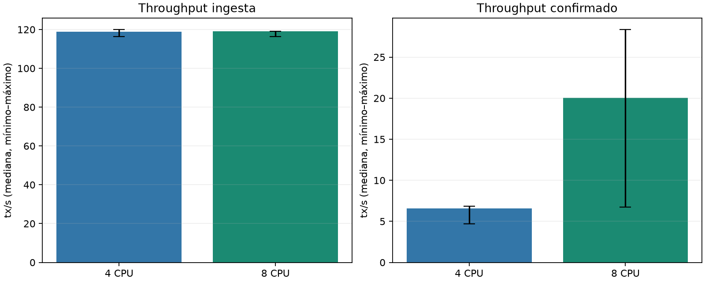

# Comparación de 4 y 8 mineros CPU

Carga: 1000 tx; prefijo fijo `0000000`; fragmentación 10.0 %. Tres corridas por punto.

Speedup confirmado (8/4): **3.048×** frente al ideal de 2×; eficiencia: **152.4 %**.

`bench.py` mide ingesta (HTTP 202). Confirmación cuenta tx de usuario en bloques sellados y divide por el tiempo desde la primera admisión hasta el último sello. Los premios y el génesis no cuentan.

Interpretar junto a métricas: ventana fija de 10 s, un bloque en minado a la vez y sellado secuencial pueden limitar el escalado. Estos son factores a investigar, no causas demostradas por el gráfico. Completar el informe con CPU/RAM, imágenes desplegadas, relojes, métricas y limitaciones observadas.

## Análisis (27/11/2026, por `https://sdmer.dpdns.org`)

| Mineros CPU | Confirmado por corrida (tx/s) | Mediana | Ingesta (mediana) |
|---:|---|---:|---:|
| 4 | 6,8 · 6,6 · 4,7 | 6,6 | 118,9 |
| 8 | 6,7 · 20,0 · 28,3 | 20,0 | 119,1 |

- **La ingesta no cambia** (~119 tx/s con 4 y con 8): la limita el ida y vuelta por Cloudflare, no los mineros.
- **El 3,05× no es un speedup real.** Ocho pods en los mismos 6 núcleos de una PC dan ~12 MH/s contra ~6,4 MH/s
  de cuatro, así que lo esperable es **menos de 2×** (~1,9×). Con prefijo 7 hay que probar 16^7 ≈ 268 M nonces en
  promedio, pero el tiempo hasta encontrar uno es exponencial: un bloque puede salir en 5 s o en 60 s. Con 3
  corridas por punto esa suerte pesa más que la diferencia de hashrate. Se ve en el rango: con 8 pods va de 6,7
  a 28,3 tx/s, y su mínimo cae dentro del rango de 4 pods.
- **Lo que sí se puede afirmar:** 8 pods confirman más rápido que 4 en mediana, y la ingesta no es el cuello. Para
  medir el speedup con precisión harían falta muchas más corridas por punto, o un prefijo más corto (6) en el que
  manda la ventana de 10 s y se vería que duplicar los mineros casi no cambia nada.
- Las corridas usaron la cadena real (bloques 800 a 830 aproximadamente), sin GPU conectada y sin otra carga.
- Primera pasada descartada: `medir_corrida.py` cerraba la ventana antes del último sellado (578 de 1000) y,
  con 8 pods, medio segundo antes de que se guardara la hora del sellado (0 de 1000). Se corrigió esperando a que
  no quede bloque en minado y con 2 s de margen; la corrida descartada no está en estos CSV.
